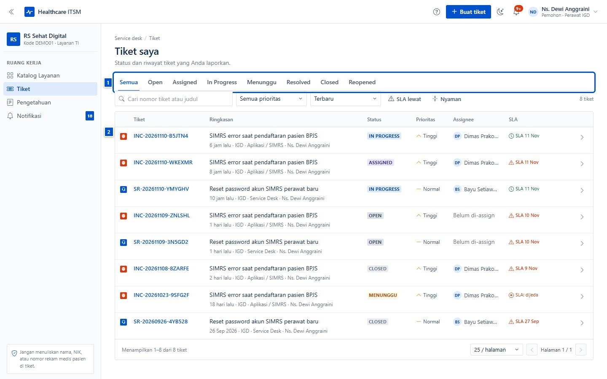
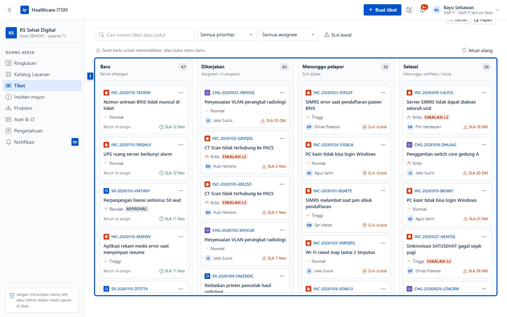
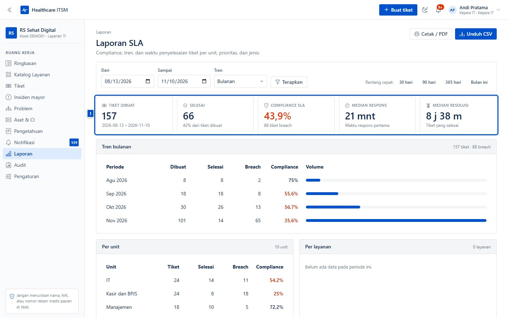

# Apa itu ITSM dan mengapa rumah sakit membutuhkannya

| | |
|---|---|
| **Untuk** | Semua pembaca — tidak perlu latar belakang TI |
| **Prasyarat** | — |
| **Waktu** | 4 menit |
| **Hasil** | Paham apa itu ITSM, manfaatnya di rumah sakit, dan kapan memakai tiket |

## 1. ITSM dalam satu paragraf

**ITSM** (*IT Service Management*) adalah cara tim TI rumah sakit mengelola
layanan secara teratur: setiap gangguan atau permintaan dicatat, diprioritaskan,
dikerjakan, dan ditutup dengan bukti — bukan lewat pesan pribadi yang mudah
hilang.

Anggap saja seperti **pendaftaran pasien, tetapi untuk layanan TI**: ada nomor
antrean (nomor tiket), ada tingkat kegawatan (prioritas), ada janji waktu
(SLA), dan ada rekam jejak (riwayat).

## 2. Satu pintu untuk semua laporan TI

Tanpa ITSM, keluhan TI masuk lewat WhatsApp, telepon, dan pintu ruang IT.
Akibatnya laporan mudah terlewat, tidak ada yang tahu siapa mengerjakan, dan
tidak ada data untuk perbaikan.

Dengan aplikasi ini, semua laporan masuk ke **satu daftar** yang sama.

- **(1) Status** — `Open` sampai `Closed`, sehingga jelas sudah sampai mana.
- **(2) Daftar tiket** — nomor, ringkasan, status, prioritas, penanggung jawab,
  dan batas waktu ada di satu tempat.

## 3. Bagaimana perjalanan sebuah laporan

1. **Lapor** — lewat aplikasi (atau QR di unit) dengan judul, deskripsi, dan
   dampak klinis.
2. **Triage** — staf IT memeriksa dan menetapkan prioritas, layanan, dan tim.
3. **Dikerjakan** — teknisi mengambil tiket, mencatat progres, dan berkomunikasi
   lewat komentar.
4. **Selesai** — ringkasan resolusi ditulis, pelapor menilai kepuasan (CSAT).
5. **Ditutup** — riwayat dan bukti tersimpan untuk audit dan perbaikan.

Papan Kanban memperlihatkan perjalanan itu sekilas:

## 4. Manfaatnya untuk rumah sakit

| Manfaat | Tanpa ITSM | Dengan ITSM |
|---|---|---|
| **Tidak ada laporan hilang** | Pesan tenggelam di chat pribadi | Semua tercatat dengan nomor tiket |
| **Prioritas berbasis dampak** | Yang paling keras bersuara didahulukan | Keselamatan pasien dan alur klinis didahulukan |
| **Waktu terukur** | "Nanti dicek" tanpa batas | SLA respons dan penyelesaian, dengan peringatan |
| **Jelas siapa mengerjakan** | Saling tunjuk | Assignee dan tim tercatat |
| **Riwayat & audit** | Tidak ada bukti | Komentar, status, dan audit log tersimpan |
| **Perbaikan berulang** | Masalah sama diulang dari nol | Problem, known error, dan artikel pengetahuan |
| **Laporan untuk manajemen** | Perkiraan | Angka SLA, tren, dan kepuasan pelapor |

Laporan berkala membantu Kepala IT menunjukkan beban kerja dan kualitas layanan
ke manajemen — bukan berdasarkan kesan, tetapi data tiket.

## 5. Peran dalam alur ini

| Peran | Tugas utama |
|---|---|
| **Pemohon** (perawat, staf unit) | Melaporkan gangguan/permintaan dan memantau tiketnya |
| **Kepala unit** | Menyetujui permintaan dari unitnya |
| **Staf IT / teknisi** | Menindaklanjuti, mengerjakan, dan menyelesaikan tiket |
| **Kepala IT** | Mengelola layanan, tim, SLA, dan laporan |
| **Pengamat** | Membaca laporan untuk pengawasan |

Penjelasan lengkap ada di [lampiran](99-lampiran.md), dan tugas per peran ada di
bab 02 dan 03.

## 6. Yang bukan ITSM

- **Bukan pengganti SIMRS.** SIMRS menangani data klinis dan administrasi
  pasien; ITSM menangani layanan TI yang menopangnya.
- **Bukan kanal data pasien.** Jangan menulis nama, NIK, nomor rekam medis, atau
  alamat pasien di tiket, komentar, atau lampiran.
- **Bukan pengganti jalur darurat.** Untuk kegawatan pasien, ikuti protokol
  klinis rumah sakit; tiket TI bukan jalur komunikasi darurat medis.

## 7. Kapan memakai tiket

Gunakan tiket bila:

- ada gangguan yang perlu ditindaklanjuti dan dipantau;
- ada permintaan yang butuh persetujuan atau jadwal;
- Anda ingin bukti dan riwayat penanganan.

Telepon service desk tetap boleh untuk hal mendesak, **tetapi tetap buat
tiketnya** agar tercatat dan tidak hilang. Satu masalah, satu tiket.

> Mulai dari bab [01](01-masuk-dan-akun.md) untuk masuk dan mengatur akun, atau
> langsung ke bab [02](02-pemohon.md) bila Anda ingin membuat tiket sekarang.
