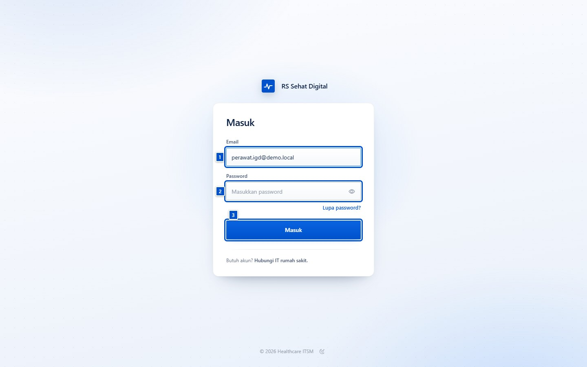
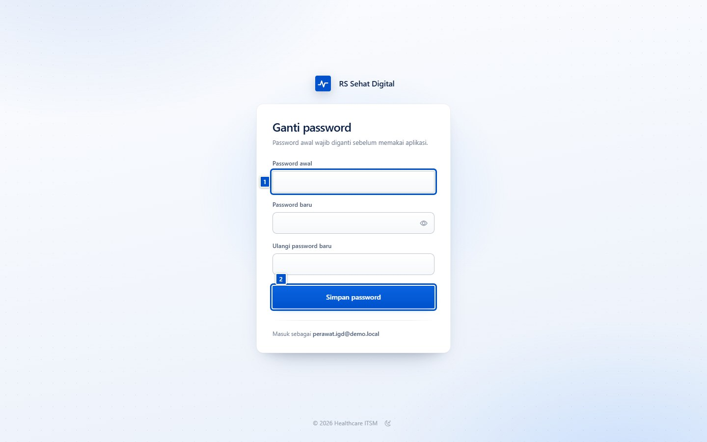
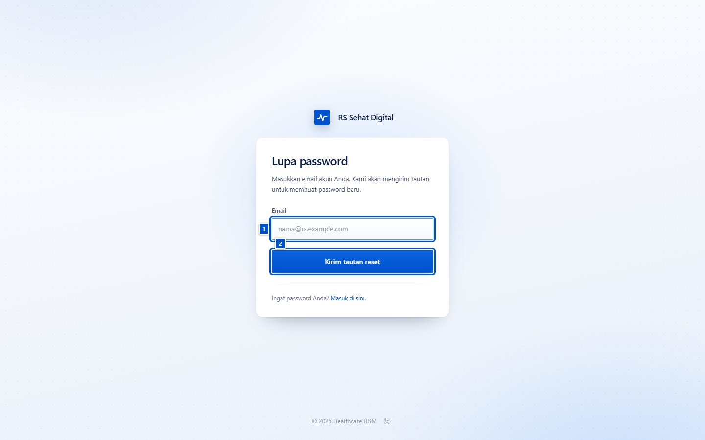
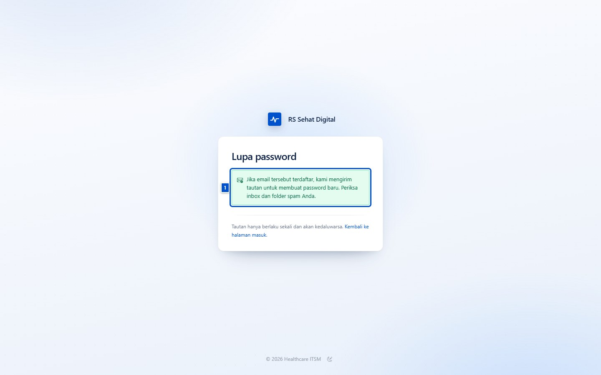
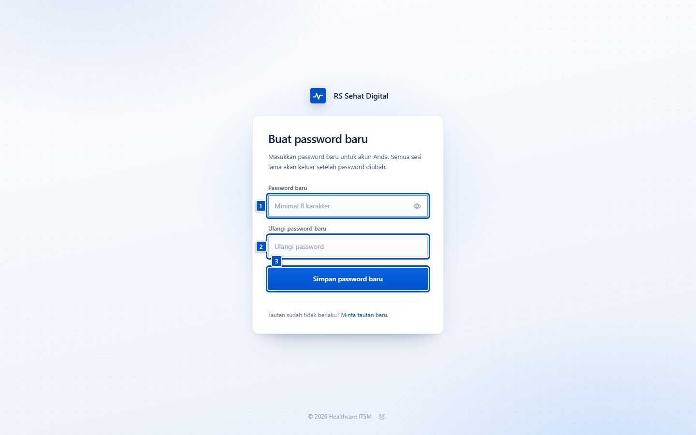
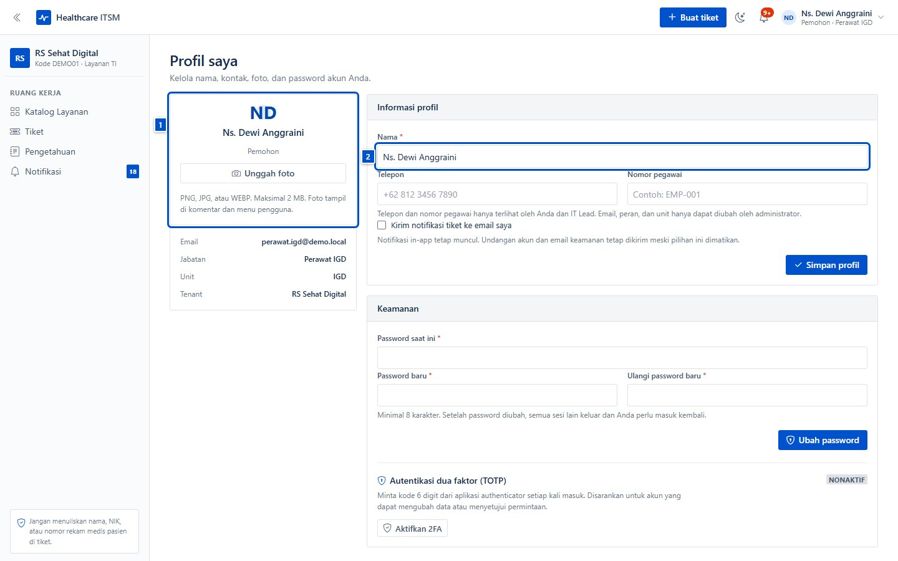
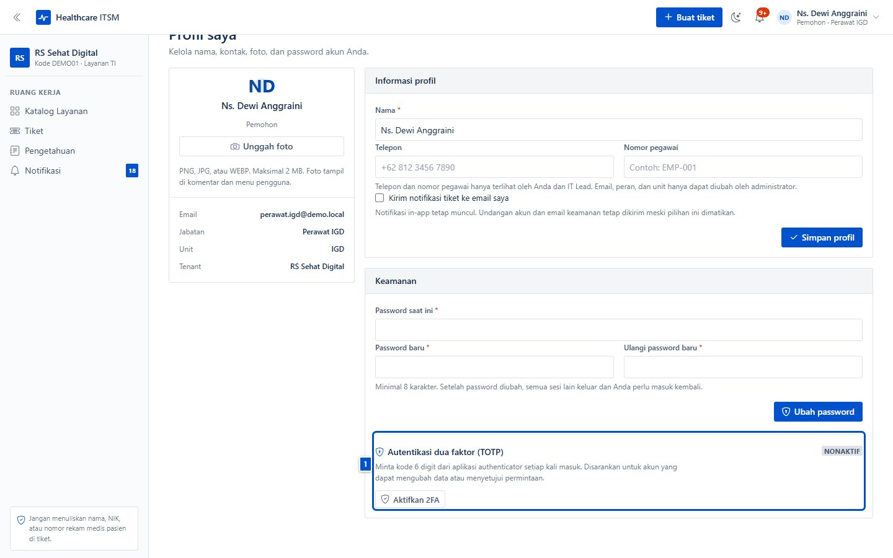
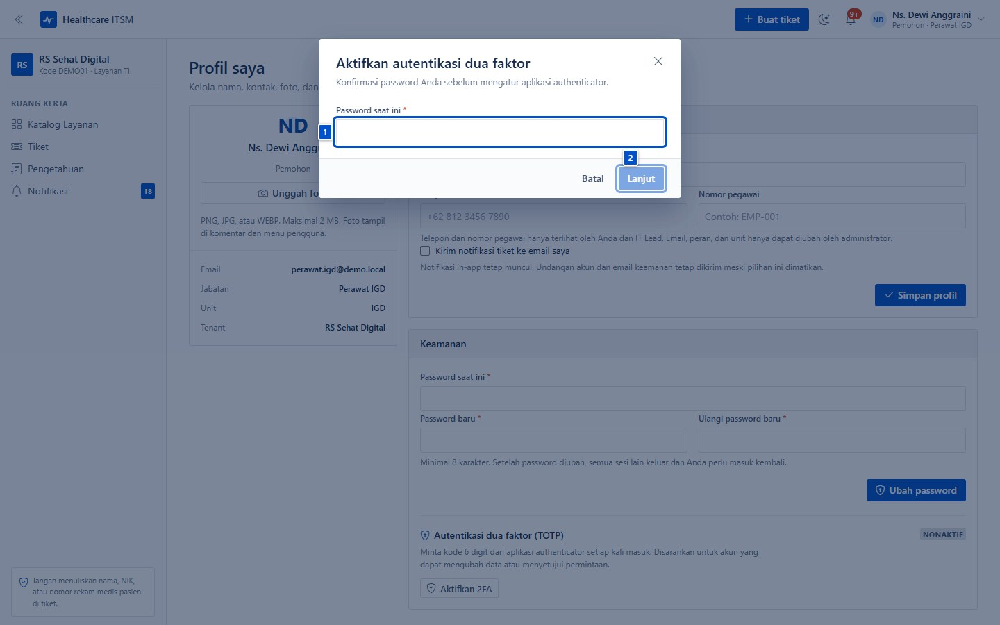
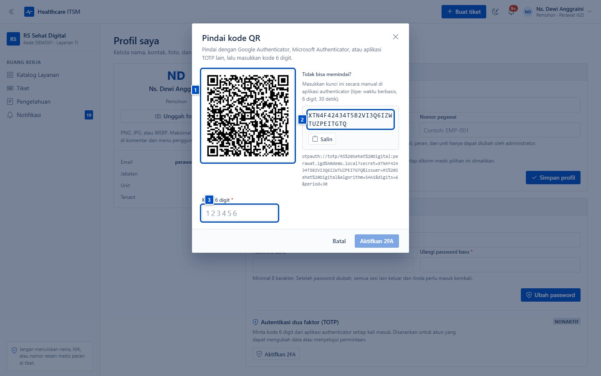
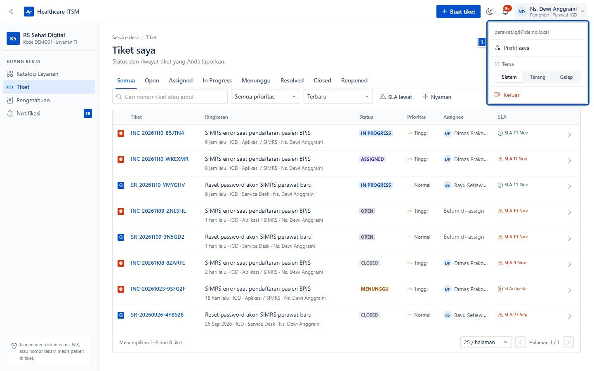

# Masuk, akun, dan keamanan

| | |
|---|---|
| **Untuk** | Semua pengguna aplikasi |
| **Prasyarat** | Akun dibuatkan oleh IT rumah sakit (Kepala IT) |
| **Waktu** | ± 3 menit untuk masuk; ± 10 menit bila mengaktifkan 2FA |
| **Hasil** | Bisa masuk, password terganti bila perlu, dan akun terlindungi 2FA |

Bab ini memakai akun demo **Ns. Dewi Anggraini** (perawat IGD) di rumah sakit
demo *RS Sehat Digital*. Layar Anda sama, kecuali nama dan email.

> **Jangan bagikan password.** Setiap orang memakai akunnya sendiri agar audit
> dan riwayat tiket tetap benar. Di komputer bersama (nurse station, ruang
> tunggu), selalu klik **Keluar** setelah selesai.

## 1. Masuk ke aplikasi

Buka alamat aplikasi rumah sakit, lalu isi **email** dan **password** yang
diberikan IT.

- **(1) Email** — alamat email kantor yang didaftarkan IT.
- **(2) Password** — password awal dari email undangan.
- **(3) Masuk** — tombol untuk membuka sesi.

Kalau lupa password, gunakan tautan **Lupa password?** di bawah kolom password
(bagian 3). Kalau email atau password salah, pesan kesalahan muncul di atas
form; periksa huruf besar/kecil dan spasi.

> Akun yang baru dibuat memakai password sementara. Saat pertama kali masuk,
> aplikasi langsung meminta Anda menggantinya — lihat bagian 2.

## 2. Mengganti password saat pertama kali masuk

Password awal wajib diganti sebelum Anda bisa memakai aplikasi. Halaman ini
muncul otomatis setelah login pertama.

1. Isi **(1) Password awal** — password sementara dari email undangan.
2. Isi **password baru** dan ulangi di kolom konfirmasi. Minimal 8 karakter,
   dan harus berbeda dari password awal.
3. Klik **Simpan password**.

Setelah tersimpan, semua sesi lama berakhir dan Anda masuk lagi memakai password
baru. Simpan password di pengelola password, bukan di catatan tempel.

## 3. Lupa password

Kalau tidak bisa masuk, minta tautan reset lewat email. Tautan hanya berlaku
sekali dan akan kedaluwarsa.

Buka **Lupa password?** di halaman masuk, lalu isi email akun Anda.

Setelah mengirim, aplikasi selalu menampilkan pesan yang sama — baik email
terdaftar maupun tidak — agar tidak bisa dipakai menebak akun.

Buka email dari aplikasi, lalu klik tombol **Buat password baru** di email
tersebut. Halaman yang terbuka meminta password baru dua kali.

- Minimal 8 karakter; gunakan kalimat panjang yang mudah Anda ingat.
- Setelah berhasil, semua sesi lama keluar dan Anda masuk dengan password baru.
- Kalau tautan sudah kedaluwarsa, minta tautan baru dari halaman lupa password.

## 4. Profil dan kontak

Klik nama Anda di kanan atas, lalu **Profil saya**. Di sini Anda bisa mengubah
foto, nama, telepon, dan nomor pegawai.

- **(1) Foto dan identitas** — unggah foto PNG/JPG/WEBP maksimal 2 MB. Foto
  tampil di komentar dan menu pengguna.
- **(2) Nama** — nama yang terlihat oleh tim IT di tiket dan komentar.

Email, peran, unit, dan tim hanya dapat diubah administrator. Centang **Kirim
notifikasi tiket ke email saya** bila ingin salinan notifikasi tiket masuk ke
email; notifikasi in-app tetap muncul meski pilihan ini dimatikan.

## 5. Mengganti password dari profil

Selain saat pertama masuk, password bisa diganti kapan saja lewat panel
**Keamanan** di halaman profil.

Isi password saat ini, password baru, dan ulangi password baru, lalu klik
**Ubah password**. Semua sesi lain langsung berakhir — praktik yang baik kalau
Anda mencurigai password pernah diketahui orang lain.

## 6. Autentikasi dua faktor (2FA)

2FA menambah lapisan kedua: selain password, aplikasi meminta kode 6 digit dari
aplikasi authenticator (Google Authenticator, Microsoft Authenticator, atau
sejenisnya). Sangat disarankan untuk akun yang bisa menyetujui permintaan atau
mengubah data.

### Mengaktifkan

Di panel **Keamanan**, klik **Aktifkan 2FA**, lalu masukkan password Anda untuk
konfirmasi.

Setelah itu muncul kode QR. Pindai dengan aplikasi authenticator, atau salin
kunci di sebelahnya bila tidak bisa memindai.

1. **(1) Pindai QR** memakai aplikasi authenticator.
2. **(2) Kunci manual** — salin bila kamera tidak tersedia. Ketik di aplikasi
   dengan mode waktu (6 digit, 30 detik).
3. **(3) Kode 6 digit** — masukkan kode yang ditampilkan aplikasi, lalu klik
   **Aktifkan 2FA**.

Setelah berhasil, aplikasi menampilkan **kode pemulihan**. Kode ini hanya
ditampilkan sekali: unduh atau salin dan simpan di tempat aman. Setiap kode
hanya bisa dipakai satu kali bila perangkat authenticator hilang.

> Simpan kode pemulihan sebelum menutup jendela. Kalau kode pemulihan hilang dan
> perangkat juga hilang, IT Lead harus mereset 2FA akun Anda.

### Masuk dengan 2FA

Saat 2FA aktif, halaman masuk menampilkan kolom tambahan **Kode autentikasi dua
faktor** setelah password dimasukkan. Isi kode 6 digit dari aplikasi
authenticator, atau salah satu kode pemulihan, lalu klik **Masuk**.

### Menonaktifkan

Klik **Nonaktifkan 2FA** di panel Keamanan, lalu konfirmasi dengan password dan
kode 6 digit yang sedang berlaku. Nonaktifkan hanya bila benar-benar perlu;
akun tanpa 2FA lebih mudah disalahgunakan.

## 7. Keluar

Klik nama Anda di kanan atas, lalu **Keluar**. Menu yang sama juga berisi
**Profil saya** dan pilihan tema (Sistem, Terang, Gelap).

Di komputer bersama, jangan hanya menutup tab browser — klik **Keluar** agar
sesi tidak bisa dipakai orang berikutnya.

## Kalau macet

| Gejala | Penyebab umum | Yang dilakukan |
|---|---|---|
| "Email atau password salah" | Salah ketik, Caps Lock, atau password lama | Periksa, lalu pakai **Lupa password?** |
| Tidak menerima email reset | Email salah, di folder spam, atau batas kirim tercapai | Periksa spam; tunggu satu menit lalu minta lagi |
| Tautan reset "tidak valid atau kedaluwarsa" | Tautan sudah dipakai atau lebih dari masa berlaku | Minta tautan baru dari halaman lupa password |
| Diminta kode 2FA tetapi aplikasi hilang | Perangkat tidak tersedia | Pakai kode pemulihan; bila habis, minta IT Lead mereset 2FA |
| Kode 2FA ditolak | Jam perangkat tidak sinkron | Aktifkan waktu otomatis, lalu coba kode berikutnya |
| Tidak bisa mengganti email/unit | Data itu hanya bisa diubah administrator | Hubungi IT Lead |
| Akun terkunci setelah beberapa percobaan | Perlindungan dari percobaan login berulang | Tunggu beberapa menit, lalu coba lagi |

## Kebiasaan aman

- Pakai password panjang yang unik; jangan pakai ulang password dari aplikasi lain.
- Aktifkan 2FA, terutama untuk akun approver dan admin.
- Simpan kode pemulihan 2FA di tempat aman, bukan di chat.
- Selalu **Keluar** di komputer bersama.
- Laporkan ke IT kalau menerima email reset yang tidak Anda minta.
