# Membuat dan memantau tiket

| | |
|---|---|
| **Untuk** | Perawat, staf unit, dan siapa pun yang melaporkan gangguan atau meminta layanan TI |
| **Prasyarat** | Sudah punya akun dan bisa masuk ke aplikasi |
| **Waktu** | ± 5 menit untuk tiket pertama |
| **Hasil** | Tiket bernomor `INC-…` / `SR-…` / `CHG-…` masuk antrean tim IT dan bisa dipantau |

Bab ini memakai akun demo **Ns. Dewi Anggraini** (perawat IGD) di rumah sakit demo
*RS Sehat Digital*. Layar Anda akan terlihat sama, kecuali nama dan isi tiket.

> **Aturan pertama, sebelum apa pun:** tiket **tidak boleh** memuat nama pasien,
> NIK, nomor rekam medis, alamat, atau data identitas pasien lainnya. Kalau
> membutuhkan data itu, gunakan kanal aman yang ditentukan rumah sakit. Sistem
> akan menolak tiket tanpa pernyataan (attestation) di langkah terakhir.

## 1. Halaman "Tiket saya"

Setelah masuk, staf non-IT langsung diarahkan ke **Tiket**. Halaman ini berisi
semua tiket yang Anda laporkan beserta status dan batas waktunya.

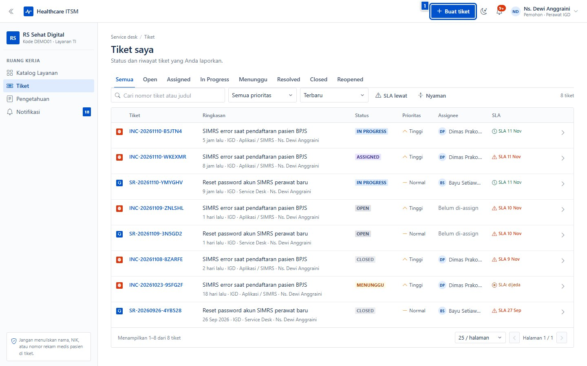

Yang perlu Anda kenali:

- **(1) Buat tiket** — tombol biru di kanan atas, selalu tersedia di halaman mana pun.
- **Tab status** — `Semua`, `Open`, `Assigned`, `In Progress`, `Menunggu`,
  `Resolved`, `Closed`, `Reopened`. Tab `Closed` berguna untuk mencari tiket lama.
- **Kolom Ringkasan** — jenis tiket, unit, layanan, dan siapa yang sedang menangani.
- **Kolom SLA** — batas waktu respons/penyelesaian. Tanda ⚠ berarti batas itu
  sudah atau hampir lewat.

## 2. Membuat tiket dalam tiga langkah

### Langkah 1 — jenis tiket, layanan, dan dampak

Klik **Buat tiket**, lalu pilih jenis tiket:

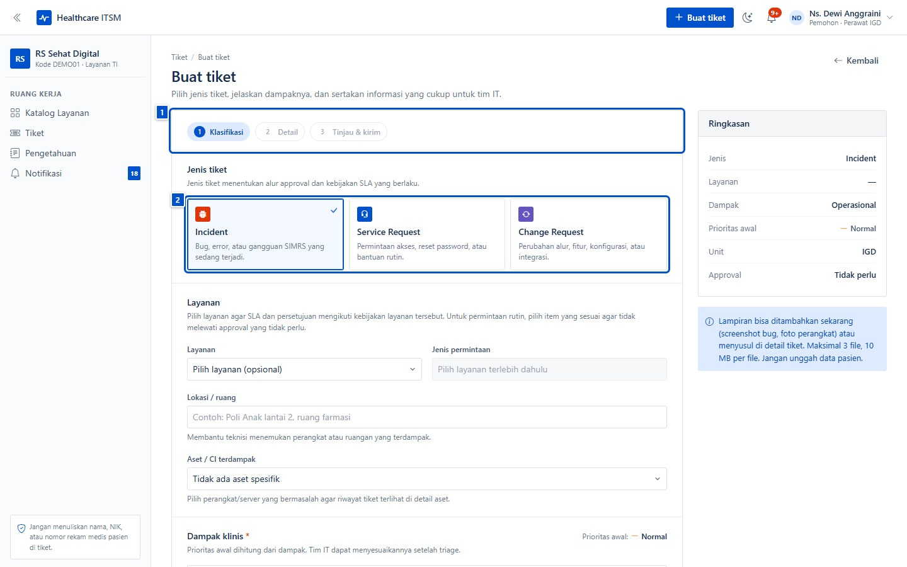

| Jenis | Kapan dipakai | Approval |
|---|---|---|
| **Incident** | Ada yang rusak atau error sekarang (SIMRS tidak bisa menyimpan, printer mati) | Tidak perlu |
| **Service Request** | Permintaan rutin: akun baru, reset password, tambah akses | Mengikuti kebijakan layanan |
| **Change Request** | Perubahan konfigurasi, alur, atau integrasi yang direncanakan | Kepala IT / CAB |

Kemudian pilih **Layanan**. Ini menentukan SLA dan siapa yang akan menangani.

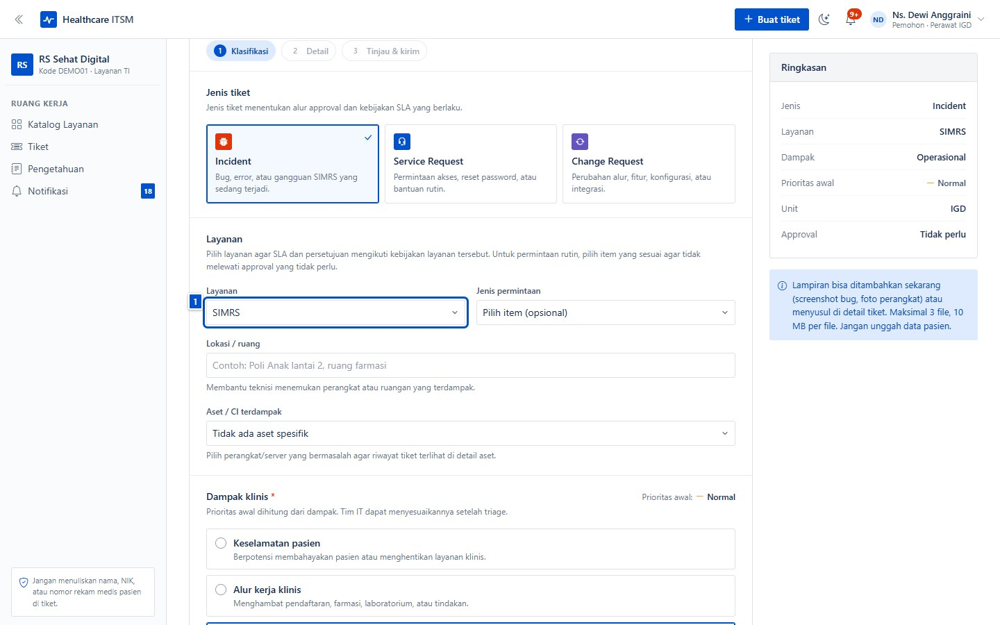

Terakhir, pilih **Dampak klinis**. Pilihan ini menentukan prioritas awal tiket —
pilih yang paling jujur, bukan yang paling mendesak:

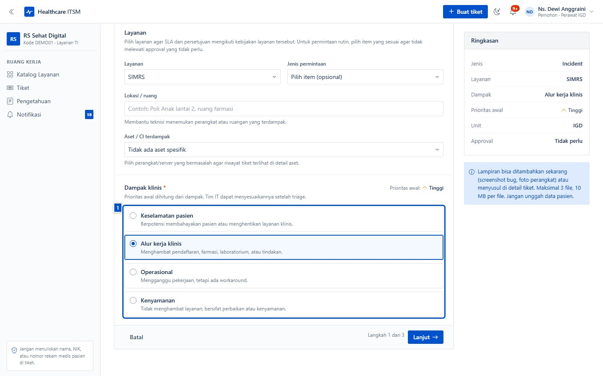

- **Keselamatan pasien** → prioritas *Critical*
- **Alur kerja klinis** → prioritas *High*
- **Operasional** → prioritas *Normal*
- **Kenyamanan** → prioritas *Low*

Isi juga **Lokasi / ruang** bila Anda tahu (mis. "Poli Anak lantai 2"); ini
membantu teknisi menemukan perangkat yang dimaksud. Kolom **Aset / CI** opsional.

### Langkah 2 — detail dan lampiran

Tulis **judul** yang spesifik dan **deskripsi** yang cukup untuk ditriase tanpa
harus bertanya balik:

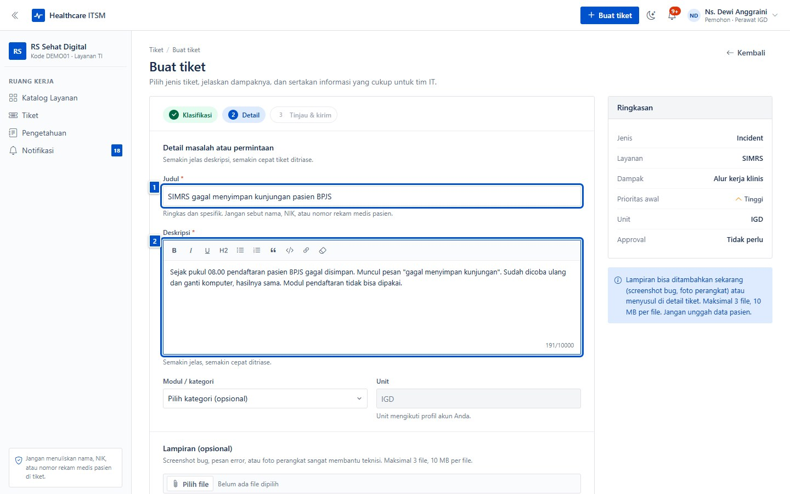

Judul yang baik: *"SIMRS gagal menyimpan kunjungan pasien BPJS"*. Judul yang
kurang membantu: *"Error"* atau *"Tolong dicek"*.

Deskripsi sebaiknya memuat:

1. Apa yang terjadi dan pesan error yang muncul.
2. Sejak kapan (jam dan tanggal).
3. Modul/unit yang terdampak dan apakah ada workaround.
4. Apa yang sudah dicoba.

Kalau ada screenshot pesan error, tambahkan lewat **Pilih file**. Maksimal 3
file, 10 MB per file (PDF, PNG, JPG, WEBP, TXT, LOG).

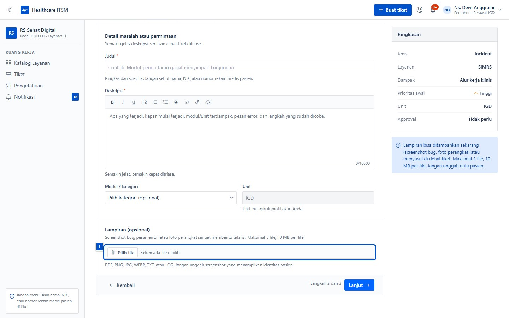

> Jangan mengunggah screenshot yang masih menampilkan identitas pasien. Potong
> atau tutupi bagian itu lebih dulu.

### Langkah 3 — tinjau dan kirim

Periksa ringkasan di kanan, lalu centang pernyataan bahwa tiket tidak memuat
data pasien, dan klik **Buat tiket**.

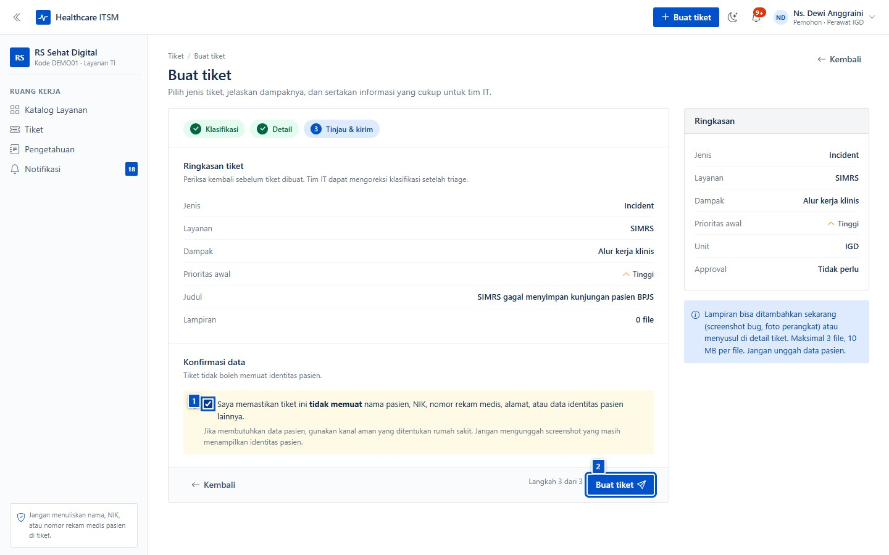

Setelah terkirim, tiket mendapat nomor (mis. `INC-20261110-AB12CD`). Nomor ini
yang dipakai saat menghubungi service desk. Tim IT menerima notifikasi, dan
Anda bisa memantau statusnya di halaman **Tiket**.

## 3. Memesan lewat katalog layanan

Kalau yang Anda butuhkan adalah permintaan rutin (bukan gangguan), buka
**Katalog Layanan**. Setiap kartu menjelaskan layanan, siapa yang menangani,
dan approval yang berlaku.

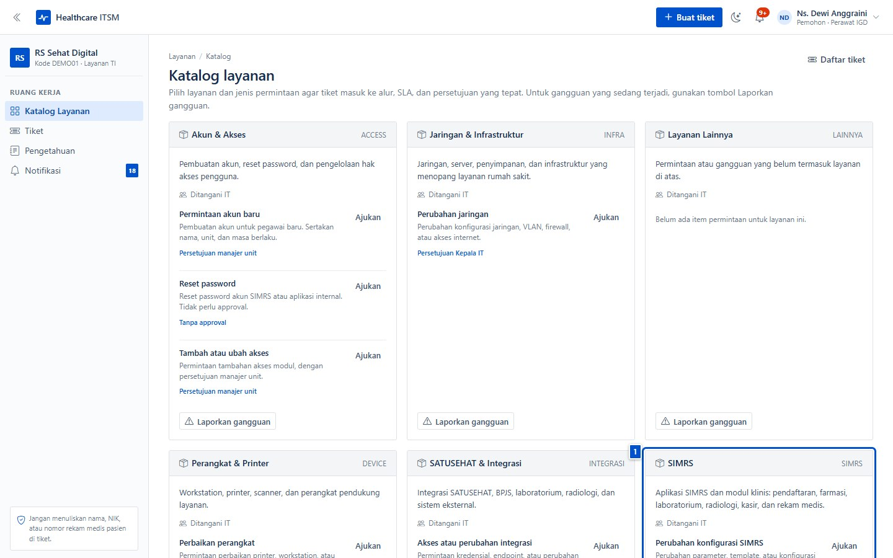

Klik **Ajukan** pada item yang sesuai untuk membuka formulir tiket yang sudah
terisi jenis dan layanannya. Untuk gangguan yang sedang terjadi, gunakan
**Laporkan gangguan** atau tombol **Buat tiket** seperti biasa.

## 4. Membaca detail tiket

Klik nomor tiket di daftar untuk membuka detailnya.

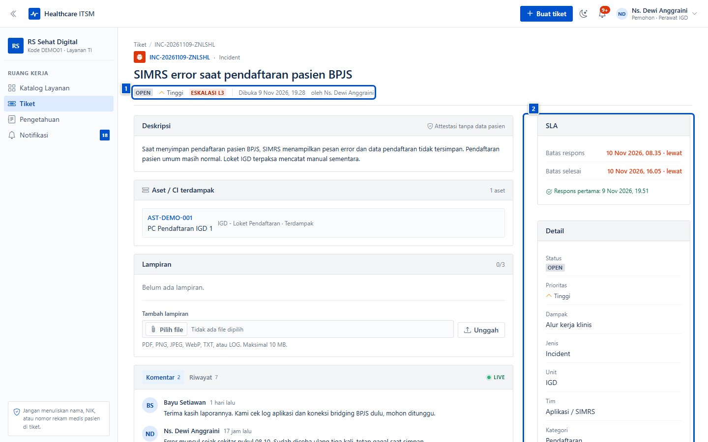

- **(1) Baris status** — status saat ini, prioritas, dan siapa yang membuka tiket.
- **(2) Panel SLA** — batas respons, batas approval, dan batas selesai. Warna
  merah berarti batas itu sudah lewat.
- **Deskripsi** — penjelasan yang Anda tulis, dengan penanda "Attestasi tanpa
  data pasien".
- **Lampiran** — file yang Anda unggah (maksimal 3).
- **Komentar / Riwayat** — percakapan dan jejak perubahan status.

## 5. Menambah komentar dan lampiran

Komentar dipakai untuk menjawab pertanyaan teknisi atau menambahkan informasi
baru. Tulis di kotak komentar, lalu klik **Kirim komentar**.

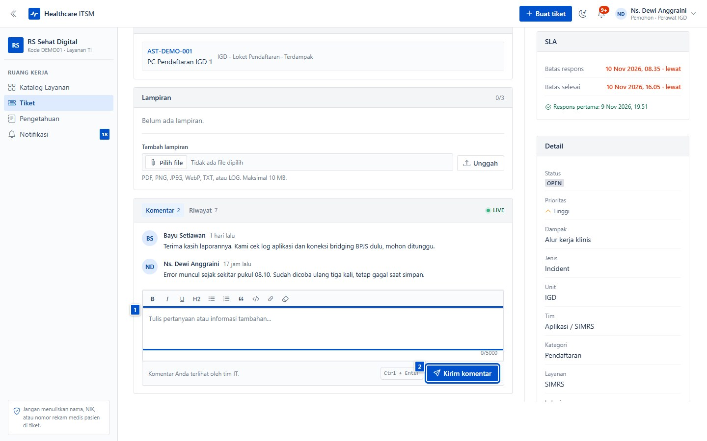

Anda juga bisa menambah lampiran setelah tiket dibuat, lewat panel **Lampiran**
di bawah deskripsi.

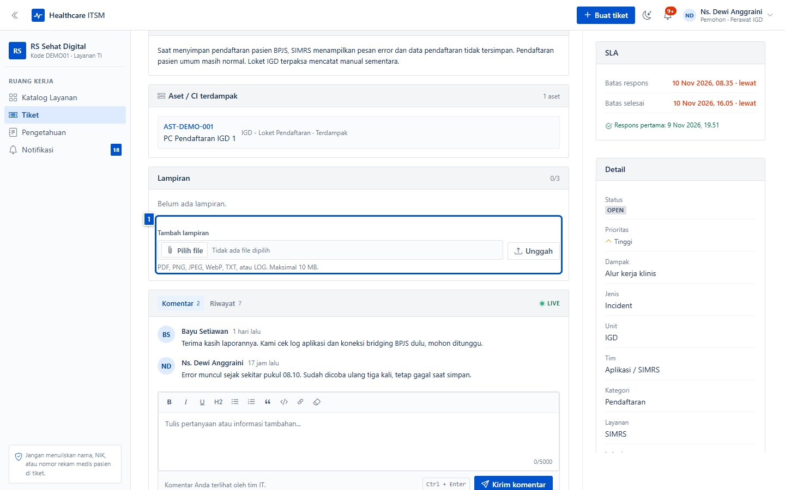

Catatan:

- Komentar Anda terlihat oleh tim IT. Komentar **internal** (khusus staf IT)
  tidak ditampilkan ke pelapor.
- Tiket yang sudah **Closed** tidak bisa dikomentari. Buka kembali dulu bila
  masalahnya berulang.

## 6. Melihat riwayat aktivitas

Tab **Riwayat** menampilkan kronologi tiket: kapan dibuat, kapan ditugaskan,
perubahan status, approval, dan eskalasi SLA.

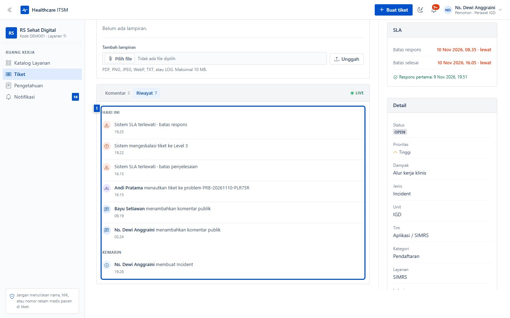

Riwayat berguna saat Anda perlu menjelaskan kronologi ke atasan atau saat
service desk menanyakan "sejak kapan ini terjadi?".

## 7. Menyetujui permintaan unit (untuk kepala unit)

Kalau Anda kepala unit, permintaan dari staf unit Anda bisa menunggu persetujuan
Anda. Buka tiketnya: tombol **Setujui**, **Tolak**, dan **Delegasikan** muncul di
bawah judul.

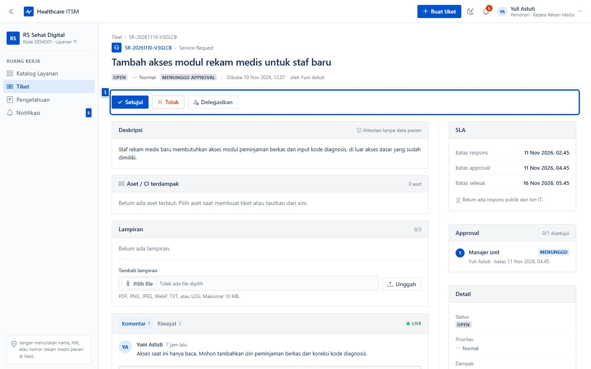

Panel **Approval** di kanan menunjukkan tahap yang sedang berjalan, siapa
approver-nya, dan batas waktunya. Permintaan yang lewat batas akan dieskalasi.

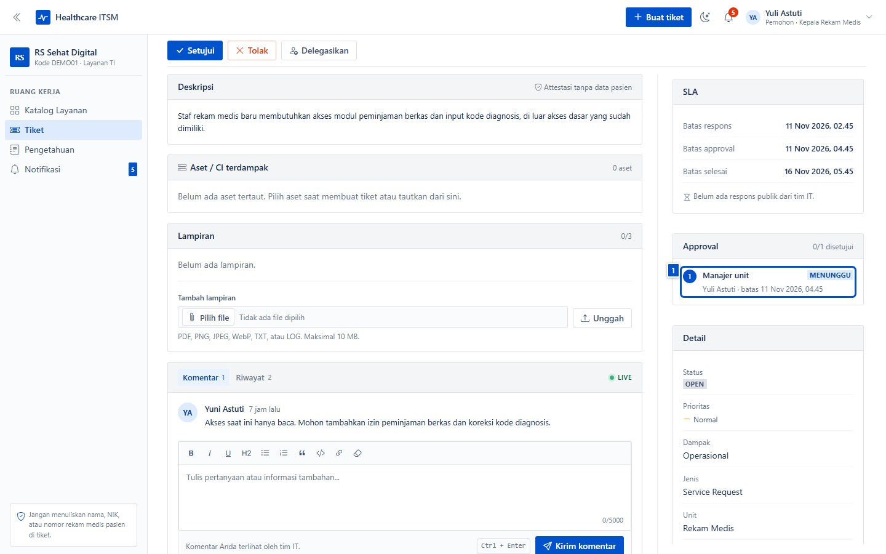

Saat menolak, tulis alasan yang jelas — alasan itu dibaca pemohon. Bila Anda
sedang tidak di tempat, gunakan **Delegasikan** ke rekan yang berwenang.

## 8. Menilai layanan (CSAT)

Setelah tiket **Resolved** atau **Closed**, Anda bisa menilai penanganannya:
pilih 1–5 bintang, tambahkan komentar bila perlu, lalu klik **Kirim penilaian**.

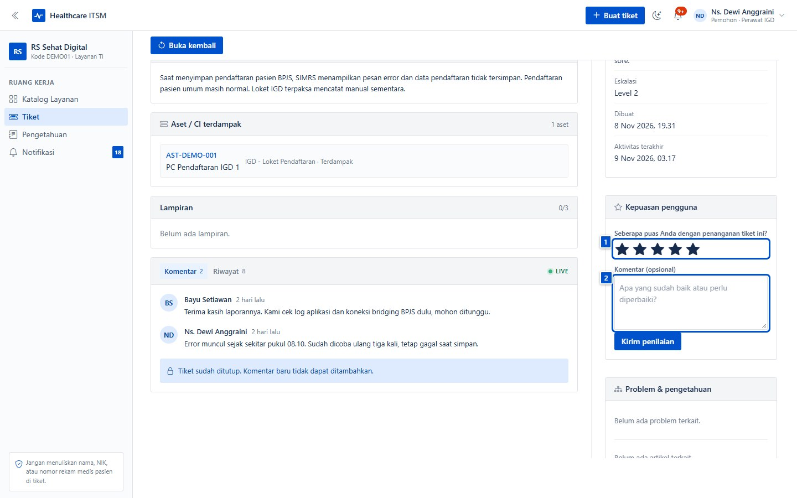

Penilaian dipakai tim IT untuk perbaikan; tidak memengaruhi status tiket. Satu
tiket hanya bisa dinilai sekali.

## 9. Membuka kembali tiket

Kalau masalah yang sama muncul lagi setelah tiket ditutup, buka tiket lama dan
klik **Buka kembali**. Tiket kembali ke antrean dengan status `Reopened` dan
riwayat sebelumnya tetap tersimpan.

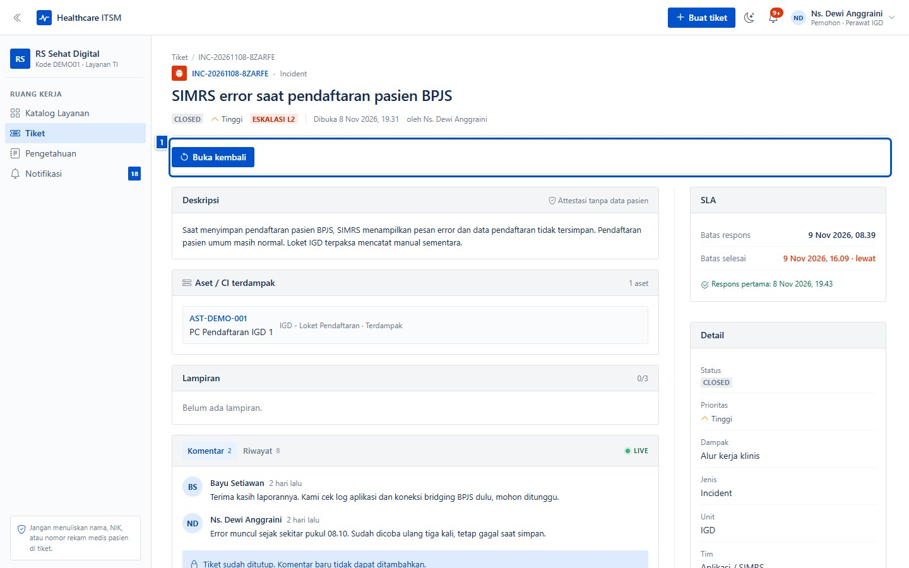

Buka kembali tiket lama hanya bila masalahnya benar-benar berulang. Untuk
masalah baru, buat tiket baru agar penanganannya tidak tercampur.

## 10. Notifikasi

Ikon lonceng di kanan atas menampilkan notifikasi terbaru; halaman **Notifikasi**
menampilkan seluruhnya, dengan filter **Semua** dan **Belum dibaca**.

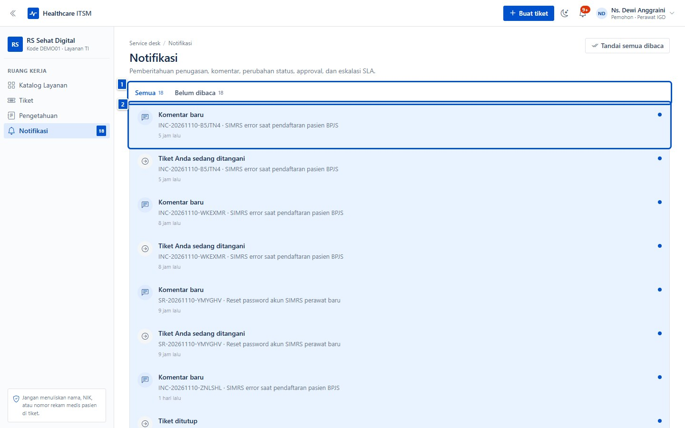

Notifikasi muncul saat tiket ditugaskan, dikomentari, berubah status, menunggu
approval, atau terkena SLA. Klik notifikasi untuk membuka tiketnya.

## 11. Mencari tiket

Di halaman **Tiket**, gunakan kotak pencarian untuk mencari nomor tiket atau
judul, lalu tekan Enter. Filter prioritas, assignee, dan tombol **SLA lewat**
membantu mempersempit daftar.

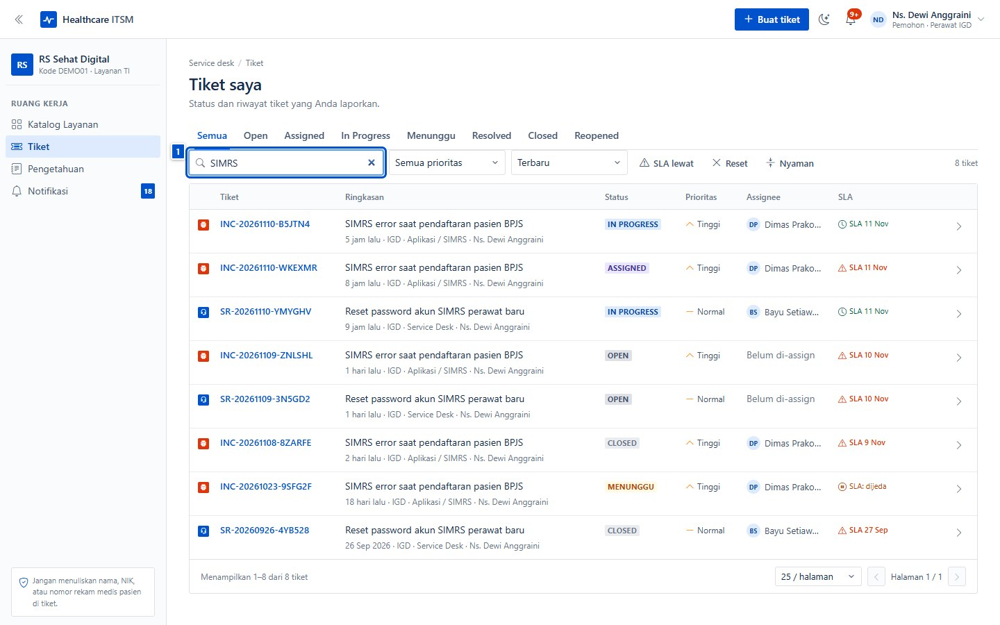

Chip "Filter aktif" di bawah kotak pencarian menunjukkan filter yang sedang
dipakai; klik **Reset** untuk kembali ke daftar penuh.

## Kalau macet

| Gejala | Penyebab umum | Yang dilakukan |
|---|---|---|
| Tombol **Buat tiket** tidak ada | Akun berperan pengamat (read-only) | Minta Kepala IT menaikkan peran |
| Muncul peringatan "Akun Anda belum memiliki unit" | Profil belum lengkap | Hubungi admin IT untuk melengkapi unit |
| Tombol **Lanjut** tidak mau jalan | Jenis, layanan, atau dampak belum dipilih | Periksa pesan error di atas form |
| Tiket tidak muncul di daftar | Filter/tab status sedang aktif | Klik **Semua** atau **Reset** |
| Tidak bisa berkomentar | Tiket sudah `Closed` | Klik **Buka kembali** bila perlu |
| Tidak bisa menyetujui | Anda bukan approver tahap yang sedang berjalan | Cek panel approval; minta delegasi bila perlu |
| Penilaian CSAT tidak muncul | Bukan pemilik tiket, atau sudah dinilai | Hanya pemohon yang bisa menilai, sekali per tiket |

## Ceklis tiket yang baik

- [ ] Satu tiket untuk satu masalah.
- [ ] Judul spesifik dan bisa dicari.
- [ ] Deskripsi memuat waktu, modul, pesan error, dan yang sudah dicoba.
- [ ] Tidak ada nama, NIK, nomor rekam medis, atau alamat pasien.
- [ ] Lampiran relevan dan sudah dibersihkan dari identitas pasien.
- [ ] Layanan dan dampak dipilih, bukan dibiarkan kosong.
