# Antrean dan pekerjaan service desk

| | |
|---|---|
| **Untuk** | Staf IT service desk, teknisi, dan resolver |
| **Prasyarat** | Akun dengan peran staf IT atau resolver, sudah masuk |
| **Waktu** | ± 15 menit untuk mengenal seluruh alur |
| **Hasil** | Tiket bisa diambil, ditriase, dikerjakan, dan diselesaikan dengan jejak audit yang benar |

Bab ini memakai akun demo **Bayu Setiawan** (staf IT) dan **Dimas Prakoso**
(teknisi aplikasi). Layar Anda sama, kecuali nama dan isi antrean.

> **Batas peran.** Staf IT dapat melihat dan mengerjakan semua tiket rumah
> sakit. Resolver hanya melihat tiket timnya dan tiket yang ditugaskan kepadanya.
> Pengamat hanya membaca laporan.

## 1. Ringkasan kerja

Setelah masuk, staf IT mendarat di **Ringkasan**. Halaman ini menjawab "apa yang
harus saya kerjakan hari ini".

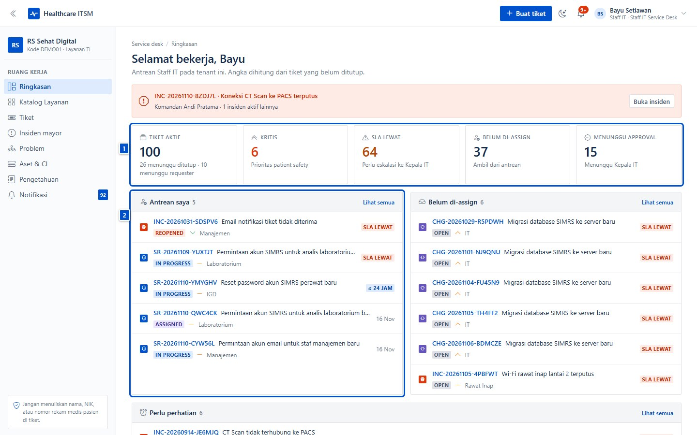

- **(1) KPI** — tiket aktif, tiket kritis, SLA lewat, belum di-assign, dan
  menunggu approval. Angka dihitung dari tiket yang belum ditutup.
- **(2) Antrean** — "Antrean saya", "Belum di-assign", dan "Perlu perhatian".
  Klik **Lihat semua** untuk membuka daftar dengan filter yang sama.
- Banner merah di atas berarti ada **insiden mayor aktif**; klik **Buka insiden**
  untuk melihat penanganannya.

## 2. Antrean tiket

Menu **Tiket** menampilkan seluruh antrean. Gunakan tampilan tersimpan dan
filter agar tidak tenggelam di ratusan tiket.

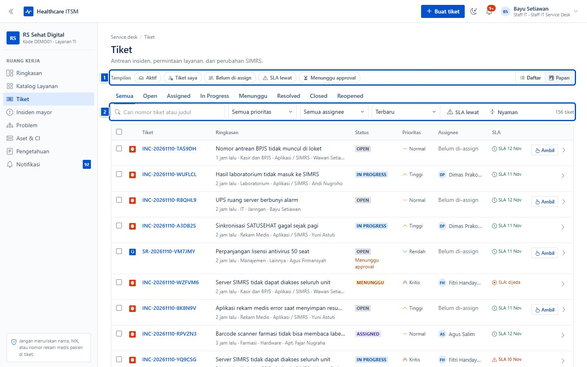

- **(1) Tampilan tersimpan** — `Aktif`, `Tiket saya`, `Belum di-assign`,
  `SLA lewat`, `Menunggu approval`. Pilihan ini tersimpan di URL, jadi bisa
  di-bookmark atau dibagikan ke rekan.
- **(2) Filter** — pencarian nomor/judul, prioritas, assignee, urutan, dan
  tombol **SLA lewat**.
- Tab status (`Open`, `Assigned`, `In Progress`, `Menunggu`, `Resolved`,
  `Closed`, `Reopened`) mempersempit daftar tanpa menghapus filter lain.
- Mode **Daftar** dan **Papan** dapat diganti kapan saja; pilihan terakhir
  diingat.

## 3. Papan Kanban

Mode **Papan** menampilkan tiket sebagai kartu di kolom status: **Baru**,
**Dikerjakan**, **Menunggu pelapor**, dan **Selesai**.

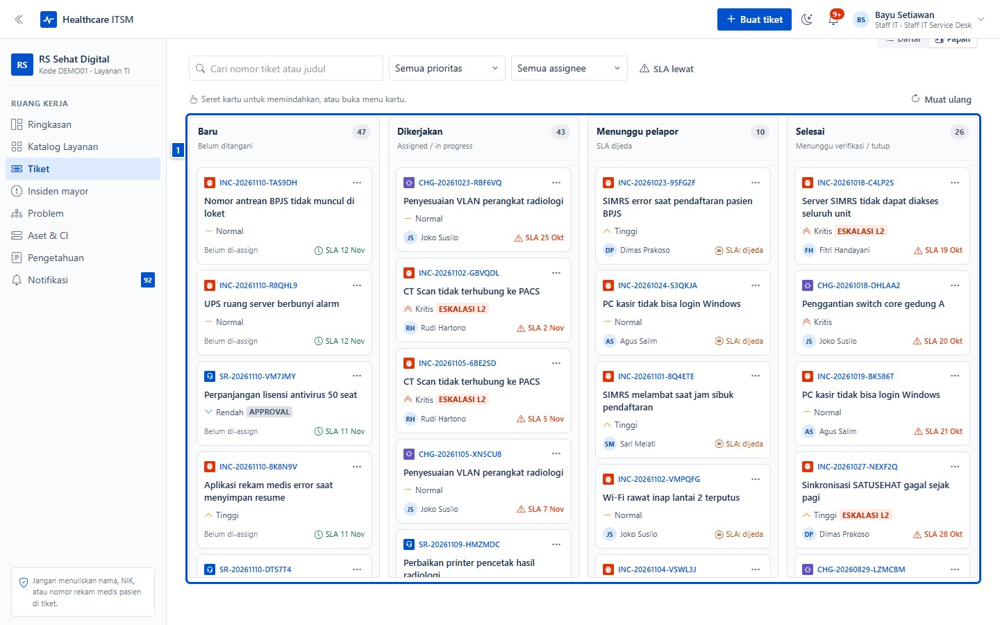

- Seret kartu ke kolom lain untuk memindahkan status, atau buka menu kartu (⋯)
  untuk aksi cepat.
- Angka di judul kolom adalah jumlah tiket pada kolom itu.
- Kartu menampilkan prioritas, assignee, dan penanda SLA; tanda ⚠ berarti batas
  waktu sudah atau hampir lewat.
- Papan mengikuti filter yang sedang aktif, jadi bersihkan filter dulu bila
  kolom terlihat kosong.

## 4. Aksi massal

Untuk membereskan antrean, centang beberapa tiket lalu pakai bilah aksi massal.

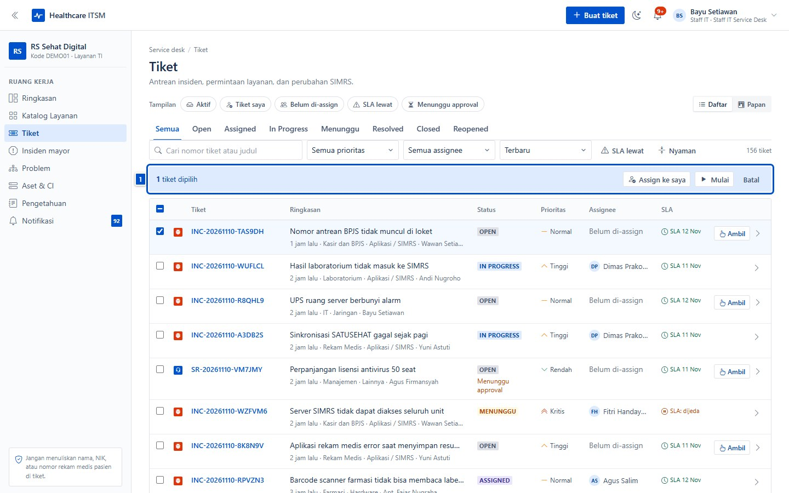

- **Assign ke saya** — mengambil kepemilikan beberapa tiket sekaligus.
- **Mulai** — memindahkan tiket ke `In Progress` (hanya untuk tiket yang sudah
  di-assign).
- **Batal** — membersihkan pilihan.

Aksi massal tetap menulis audit per tiket, jadi riwayat masing-masing tiket
tetap lengkap.

## 5. Mengambil dan mengerjakan tiket

Buka tiket dari antrean. Untuk resolver, tombol yang muncul mengikuti keadaan
tiket: **Ambil tiket**, **Mulai kerjakan**, **Tunggu**, **Selesaikan**, atau
**Tutup tiket**.

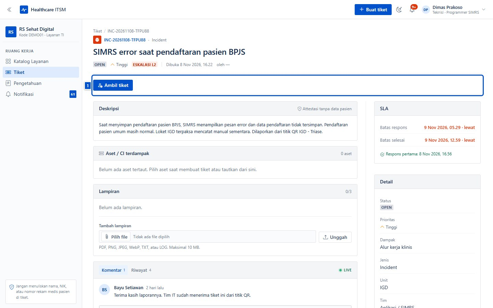

Alur yang disarankan:

1. **Ambil tiket** — menjadikan Anda assignee (resolver hanya bisa mengambil
   tiket timnya yang belum di-assign).
2. **Mulai kerjakan** — status menjadi `In Progress`; jam SLA penyelesaian
   berjalan.
3. **Tunggu** — status `Menunggu` dan SLA penyelesaian **dijeda** saat menunggu
   informasi dari pelapor atau pihak lain. Klik **Lanjutkan** untuk melanjutkan.
4. **Selesaikan** — membuka modal resolusi (bagian 7).
5. **Tutup tiket** — hanya dari status `Resolved`, setelah pelapor dikabari.

## 6. Triage sebelum bekerja

Staf IT dapat mengoreksi klasifikasi tiket sebelum pekerjaan dimulai: prioritas,
dampak klinis, kategori, layanan, item, lokasi, dan tim penanggung jawab.

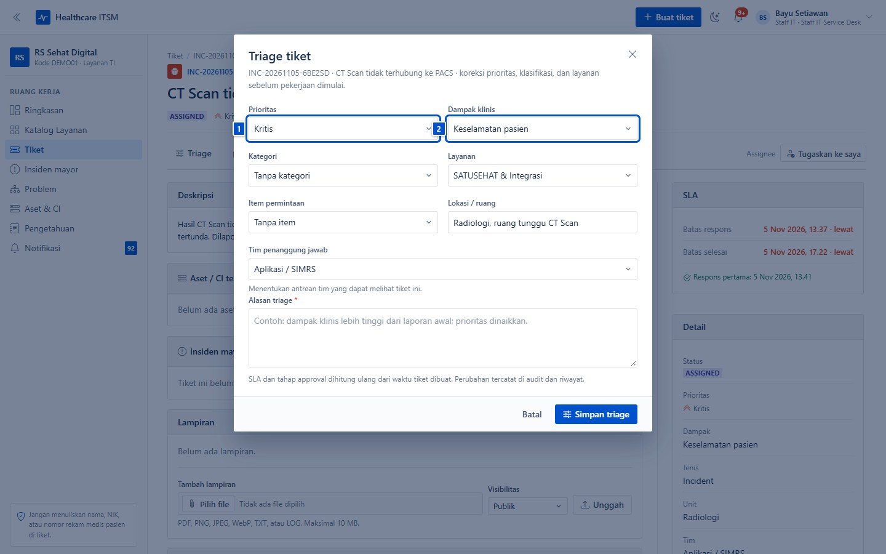

1. **(1) Prioritas** dan **(2) dampak klinis** — sesuaikan dengan kondisi nyata,
   bukan laporan awal.
2. **Tim penanggung jawab** — menentukan antrean tim yang dapat melihat tiket.
3. **Alasan triage** wajib diisi; perubahan tercatat di audit dan riwayat tiket.
4. SLA dan tahap approval dihitung ulang setelah triage, karena deadline
   mengikuti kebijakan layanan yang baru.

Triage adalah koreksi, bukan jalan pintas menaikkan prioritas tanpa alasan.
Dokumentasikan dasar perubahan di kolom alasan.

## 7. Menyelesaikan tiket

Klik **Selesaikan** untuk membuka modal resolusi. Ringkasan resolusi wajib
diisi minimal 10 karakter; inilah yang dibaca pelapor dan masuk ke laporan.

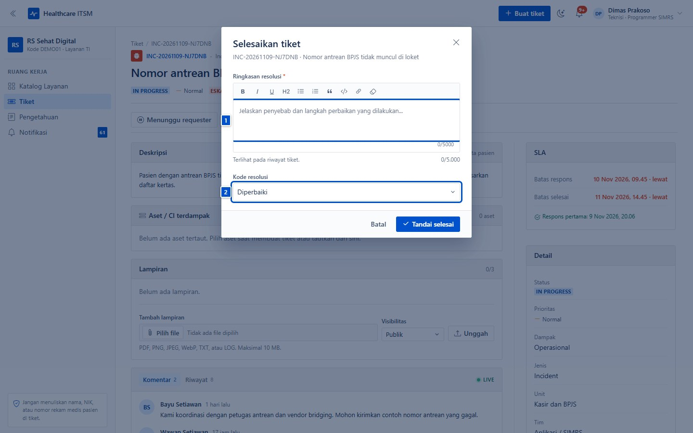

- **(1) Ringkasan resolusi** — jelaskan penyebab dan langkah perbaikan, bukan
  hanya "sudah normal".
- **(2) Kode resolusi** — `Diperbaiki`, `Workaround`, `Duplikat`, `Tidak dapat
  direproduksi`, `Ditolak`, atau `Lainnya`. Untuk Change Request, pilih juga
  hasil perubahan (berhasil, sebagian, gagal, atau rollback).
- Setelah disimpan, tiket berstatus `Resolved`; pelapor bisa membuka kembali
  atau menilai CSAT. Tiket ditutup setelah konfirmasi.

## 8. Komentar publik dan internal

Di panel komentar, pilih visibilitas sebelum mengirim:

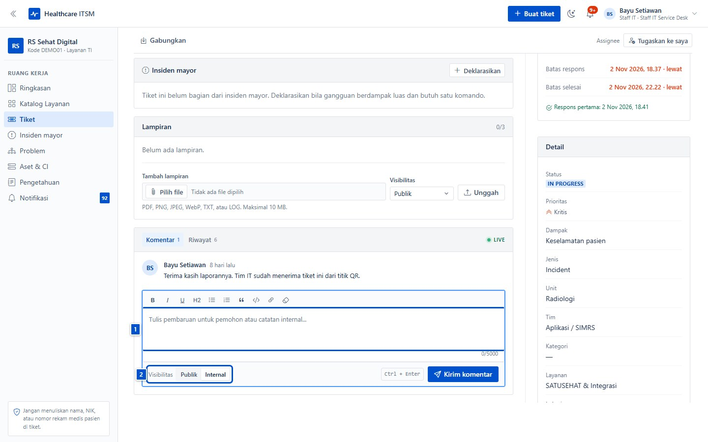

- **Publik** — terlihat oleh pelapor dan tim IT. Pakai untuk pembaruan yang
  memang perlu diketahui pelapor.
- **Internal** — hanya terlihat staf IT. Pakai untuk catatan teknis, koordinasi
  vendor, atau dugaan penyebab yang belum pasti.
- **(1) Kotak komentar** dan **(2) pilihan visibilitas** juga berlaku untuk
  lampiran: lampiran internal tidak bisa diunduh pelapor.

Jangan menulis data pasien di komentar, termasuk di komentar internal — teks
tetap tersimpan di audit dan cadangan.

## 9. SLA dan eskalasi

Panel kanan detail tiket menampilkan batas respons, batas selesai, dan waktu
respons pertama.

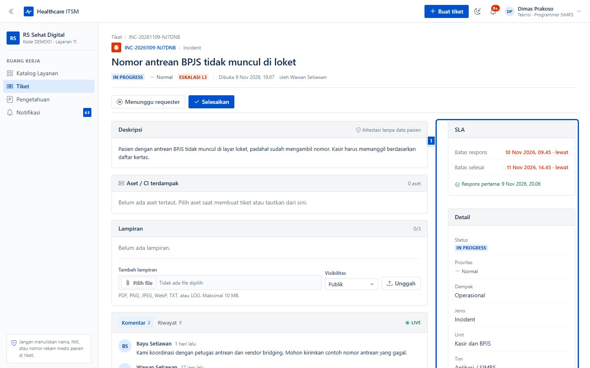

- Warna merah berarti batas waktu **sudah lewat**; badge `ESKALASI L2`/`L3`
  berarti tiket sudah dieskalasi otomatis.
- Status `Menunggu` menjeda SLA penyelesaian; jangan memakainya untuk
  menghindari SLA, karena alasan tunggu tercatat di riwayat.
- Tiket yang mendekati batas memunculkan notifikasi "SLA ... hampir lewat".
- SLA mengikuti zona waktu rumah sakit, bukan zona waktu perangkat Anda.

## 10. Menggabungkan tiket duplikat

Kalau beberapa pelapor melaporkan masalah yang sama, gabungkan ke satu tiket
induk agar penanganan dan komunikasinya tidak terpecah.

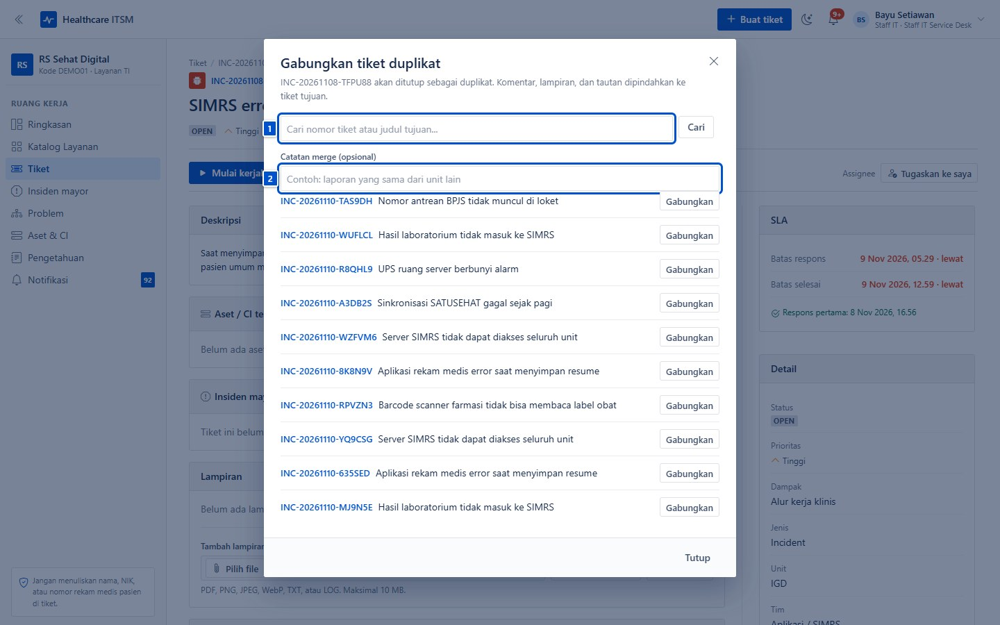

1. **(1) Cari tiket tujuan** — ketik nomor atau judul, lalu pilih **Gabungkan**.
2. **(2) Catatan merge** — jelaskan alasan (mis. "laporan yang sama dari unit
   lain").
3. Komentar, lampiran, dan tautan dipindahkan ke tiket tujuan; tiket sumber
   ditutup sebagai duplikat dan tetap bisa ditelusuri.

Merge tidak bisa dibatalkan. Pastikan tiket tujuan benar sebelum menekan
**Gabungkan**.

## 11. Problem management

Menu **Problem** mengelompokkan insiden berulang dan mendokumentasikan akar
masalah, workaround, serta known error.

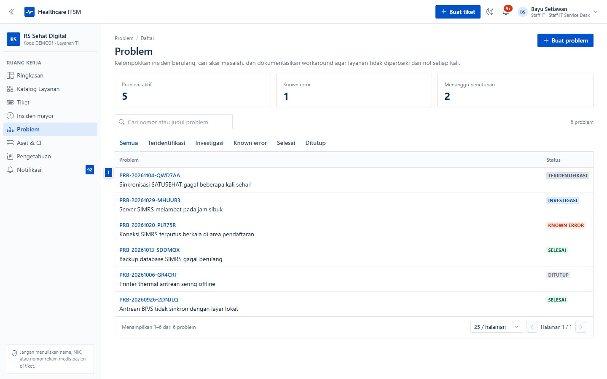

Status problem: `Teridentifikasi` → `Investigasi` → `Known error` → `Selesai` →
`Ditutup`. Problem bisa dibuat dari tiket insiden (tombol **Buat problem** di
detail tiket) atau langsung dari halaman ini.

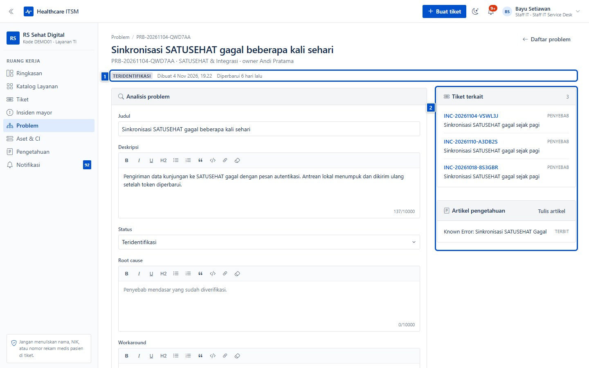

- **Root cause** dan **workaround** dipakai ulang saat insiden serupa muncul.
- **Tiket terkait** menunjukkan berapa insiden yang disatukan problem ini.
- **Artikel pengetahuan** yang tertaut memberi solusi siap pakai untuk pelapor
  dan teknisi lain.

## 12. Basis pengetahuan

Menu **Pengetahuan** menyimpan SOP, panduan, dan known error. Status artikel:
`Draft` → `Review` → `Terbit` → `Pensiun`.

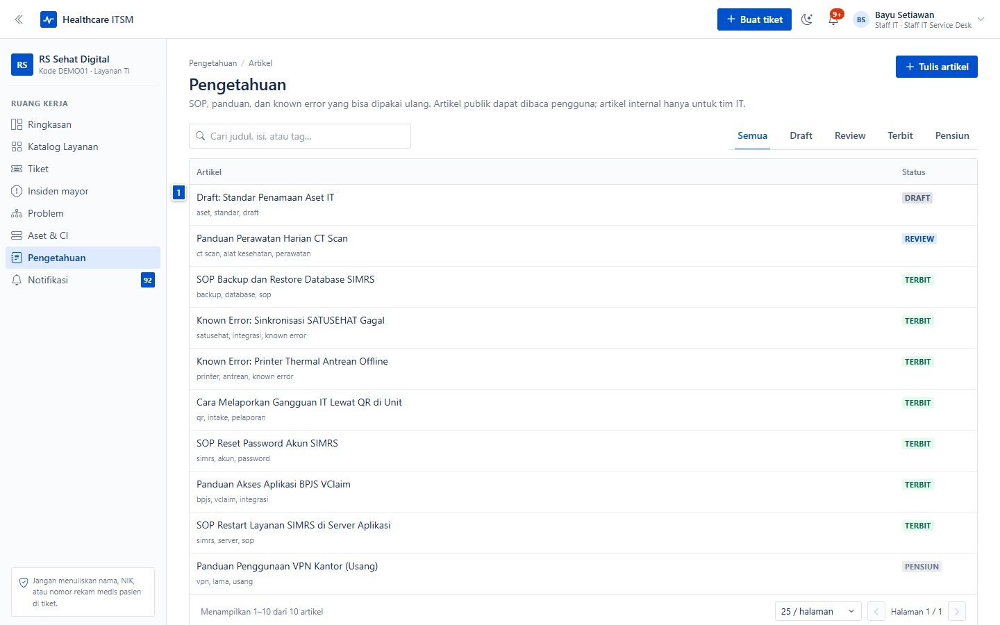

- Artikel **publik** bisa dibaca pengguna; artikel **internal** hanya untuk
  tim IT.
- Cari berdasarkan judul, isi, atau tag; gunakan tab status untuk melihat
  artikel yang perlu direview.
- Saat menutup tiket, pertimbangkan menulis artikel bila solusinya akan
  berulang.

## 13. Insiden mayor

Gangguan berdampak luas (SIMRS mati, jaringan seluruh gedung) ditangani sebagai
satu **insiden mayor**, bukan puluhan tiket lepas.

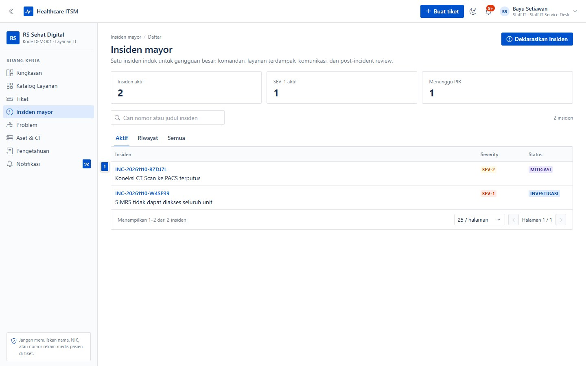

- Klik **Deklarasikan insiden** untuk membuat insiden: judul, severity,
  komandan, layanan terdampak, dan tiket sumber.
- Update komunikasi bisa bersifat publik (ikut memberi notifikasi ke pelapor
  tiket terdampak) atau internal.
- Setelah pulih, isi **PIR** (post-incident review): root cause, aksi
  perbaikan, dan pelajaran. Insiden baru bisa ditutup setelah PIR lengkap.
- Tiket bisa ditautkan ke insiden sebagai terdampak, penyebab, atau terkait.

## 14. Aset dan CI

Menu **Aset & CI** mencatat perangkat, server, lisensi, dan alat kesehatan yang
menopang layanan.

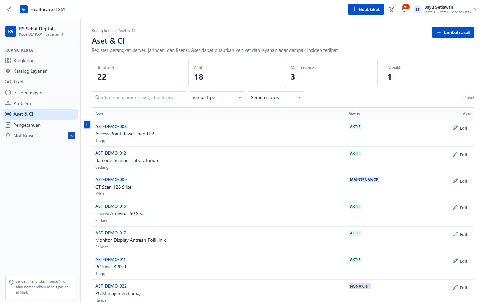

- Setiap aset punya nomor, lokasi, unit, layanan, status, dan masa garansi.
- Tiket bisa ditautkan ke aset saat membuat tiket atau dari detail tiket;
  riwayat tiket aset membantu melihat perangkat yang sering bermasalah.
- Aset juga bisa ditautkan ke layanan (service CI) untuk analisis dampak.

## Kalau macet

| Gejala | Penyebab umum | Yang dilakukan |
|---|---|---|
| Tiket tidak muncul di antrean tim | Filter/tampilan tersimpan masih aktif | Klik **Reset** atau pilih tampilan `Aktif` |
| Tombol **Ambil tiket** tidak ada | Tiket sudah di-assign, beda tim, atau bukan tiket tim Anda | Minta staf IT meng-assign, atau cek tim tiket |
| Tidak bisa **Selesaikan** | Tiket belum `In Progress`, bukan assignee, atau approval belum disetujui | Selesaikan approval dulu; ambil tiket bila perlu |
| Tombol **Gabungkan** tidak ada | Tiket sudah resolved/closed atau sudah pernah digabung | Buat tiket baru bila masalah berbeda |
| Tidak bisa mengubah prioritas | Hanya staf IT yang boleh triage | Minta staf IT melakukan triage |
| Komentar internal tidak muncul di pelapor | Memang by design | Gunakan komentar publik untuk informasi ke pelapor |

## Kebiasaan kerja yang baik

- Ambil tiket sebelum mengerjakan agar tidak ada dua orang mengerjakan hal sama.
- Tulis ringkasan resolusi yang bisa dipahami pelapor, bukan singkatan internal.
- Gunakan `Menunggu` hanya saat benar-benar menunggu pihak lain.
- Simpan catatan teknis di komentar internal, informasi untuk pelapor di publik.
- Gabungkan duplikat, jangan menyelesaikan banyak tiket untuk satu masalah.
- Tautkan aset dan problem agar riwayat perangkat dan akar masalah terlihat.
