# Pengaturan, tim, laporan, dan audit

| | |
|---|---|
| **Untuk** | Kepala IT / admin rumah sakit (peran `it_lead`) |
| **Prasyarat** | Akun dengan peran Kepala IT, sudah masuk |
| **Waktu** | ± 20 menit untuk mengenal seluruh tab |
| **Hasil** | Data master, tim, SLA, laporan, dan jejak audit dikelola dari satu tempat |

Bab ini memakai akun demo **Andi Pratama** (Kepala IT) di rumah sakit demo
*RS Sehat Digital*. Menu **Pengaturan** hanya muncul untuk peran Kepala IT.

> **Perubahan data master hanya berlaku untuk tiket baru.** Tiket lama menyimpan
> snapshot SLA saat dibuat, sehingga laporan historis tidak berubah ketika
> kebijakan diperbarui. Ini disengaja agar angka masa lalu tetap bisa
> dipertanggungjawabkan.

## 1. Peta menu Pengaturan

Menu **Pengaturan** berisi delapan tab: **Identitas**, **Unit**, **Kategori**,
**Layanan**, **Titik QR**, **Kebijakan SLA**, **Hari libur**, dan **Tim**.

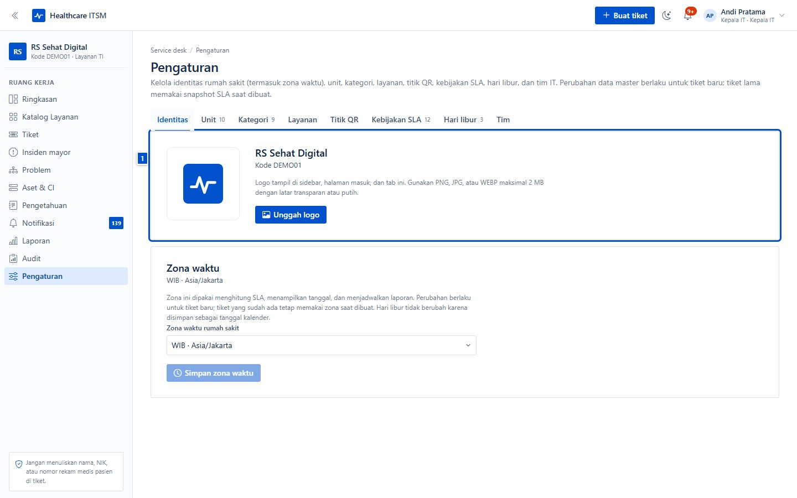

Urutan pengerjaan yang disarankan untuk rumah sakit baru:

1. Identitas dan zona waktu.
2. Unit dan kategori.
3. Layanan (katalog + item).
4. Kebijakan SLA dan hari libur.
5. Titik QR per unit.
6. Tim (undang anggota atau impor CSV).

## 2. Identitas dan zona waktu

Di tab **Identitas**:

- Unggah **logo rumah sakit** (PNG/JPG/WEBP, maksimal 2 MB). Logo tampil di
  sidebar, halaman masuk, dan tab browser.
- Pilih **zona waktu** rumah sakit. Zona ini dipakai menghitung SLA,
  menampilkan tanggal, dan menjadwalkan laporan — bukan zona waktu perangkat
  pengguna.
- Perubahan zona waktu berlaku untuk tiket baru; hari libur tetap disimpan
  sebagai tanggal kalender sehingga tidak bergeser.

## 3. Unit dan kategori

Tab **Unit** menyimpan daftar unit (IGD, Rawat Inap, Farmasi, Laboratorium,
Radiologi, Kasir, Rekam Medis, Manajemen, IT) beserta kepala unit.

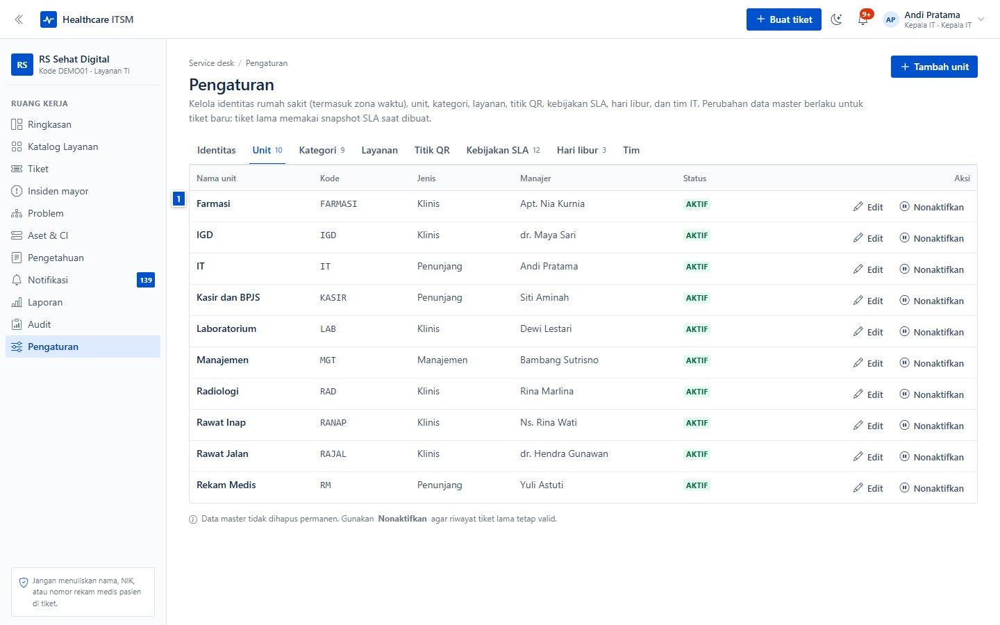

- Kepala unit dipakai sebagai approver tahap 1 untuk permintaan dari unit itu.
- Unit dipakai untuk memfilter tiket, laporan per unit, dan routing approval.
- Tab **Kategori** menyimpan kategori masalah (Pendaftaran, Farmasi,
  Laboratorium, Jaringan, dan seterusnya) untuk triase dan laporan.

Tambahkan unit/kategori sebelum mengundang tim, karena akun butuh unit.

## 4. Layanan dan item permintaan

Tab **Layanan** mengatur katalog yang dilihat pelapor dan aturan per layanan.

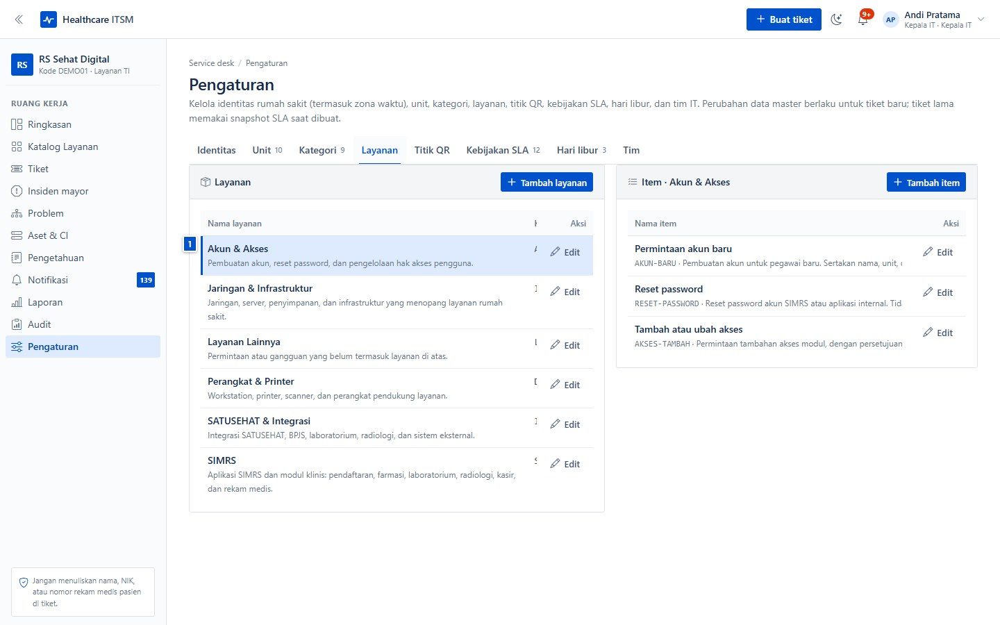

- **Layanan** punya kode, deskripsi, tim penanggung jawab, dan kebijakan SLA.
- **Item permintaan** di dalam layanan menentukan jenis permintaan yang bisa
  diajukan, mode approval (`Tanpa approval`, `Manajer unit`, `Kepala IT`,
  `CAB`), dan deskripsi bantuan.
- Item dengan approval `Manajer unit` akan meminta persetujuan kepala unit
  pemohon; `Kepala IT` meminta persetujuan Kepala IT; `CAB` menambah tahap
  kedua.
- Nonaktifkan layanan yang tidak dipakai daripada menghapusnya, agar tiket lama
  tetap menunjuk layanan yang benar.

## 5. Titik QR

Tab **Titik QR** membuat tautan intake publik per lokasi. QR hanya berisi
tautan; tidak ada data pengguna atau tiket di dalamnya.

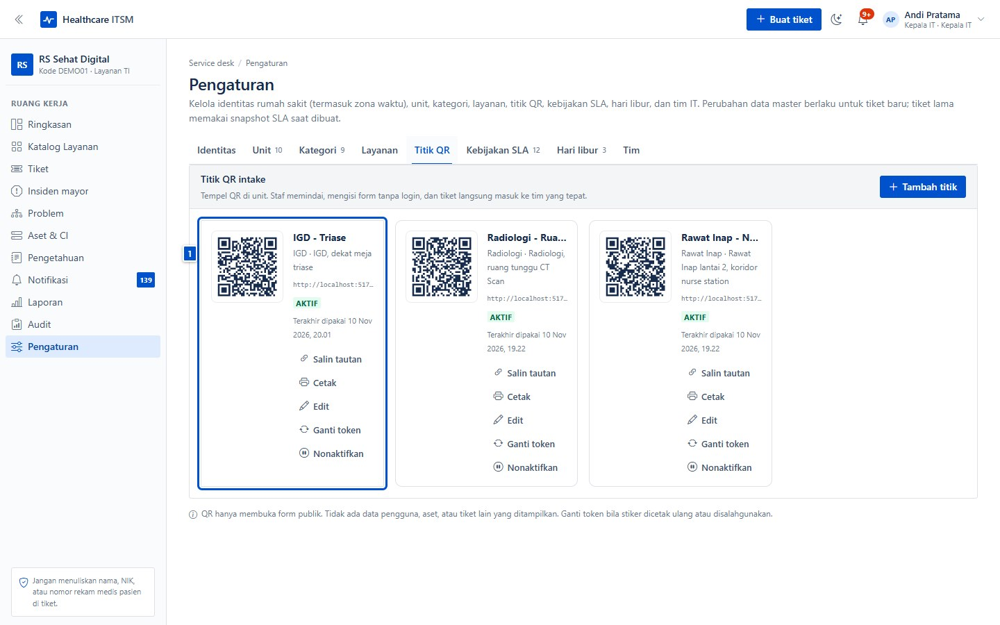

- **Tambah titik** — pilih unit, isi nama titik dan lokasi fisik (mis. "IGD,
  dekat meja triase").
- **Cetak** — unduh gambar QR berukuran siap tempel.
- **Ganti token** — membatalkan QR lama; berguna bila poster hilang atau
  disalahgunakan.
- **Nonaktifkan** — menutup intake dari titik itu tanpa menghapus riwayatnya.

Satu titik untuk satu lokasi fisik. Uji QR dari ponsel sebelum dipasang.

## 6. Kebijakan SLA

Tab **Kebijakan SLA** menentukan batas respons dan penyelesaian per prioritas.

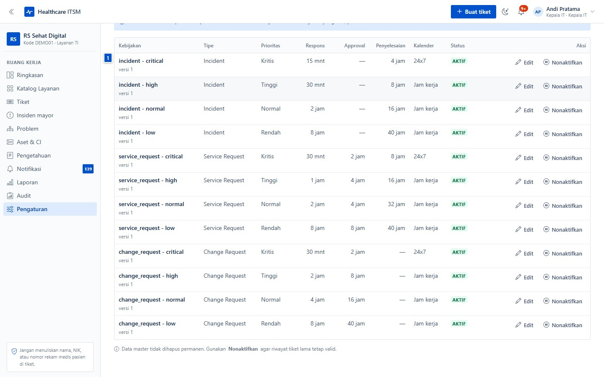

- Prioritas `Kritis`, `Tinggi`, `Normal`, `Rendah` masing-masing punya batas
  respons, batas penyelesaian, dan target approval.
- SLA dihitung dalam jam kerja rumah sakit; status `Menunggu` menjeda jam
  penyelesaian.
- Perubahan kebijakan tidak mengubah tiket lama (snapshot), tetapi berlaku
  untuk tiket baru dan perhitungan ulang setelah triage.

## 7. Hari libur

Tab **Hari libur** menandai tanggal yang tidak dihitung sebagai hari kerja
untuk SLA.

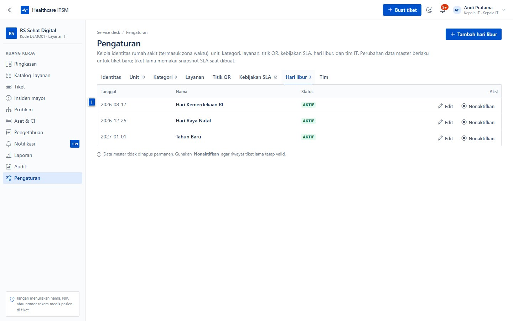

- Isi tanggal, nama hari libur, dan unit yang berlaku (kosong berarti semua
  unit).
- Hari libur disimpan sebagai tanggal kalender; aman saat zona waktu berubah.
- Perbarui setiap awal tahun agar SLA tidak melewati hari libur nasional.

## 8. Tim

Tab **Tim** mengelola akun staf rumah sakit.

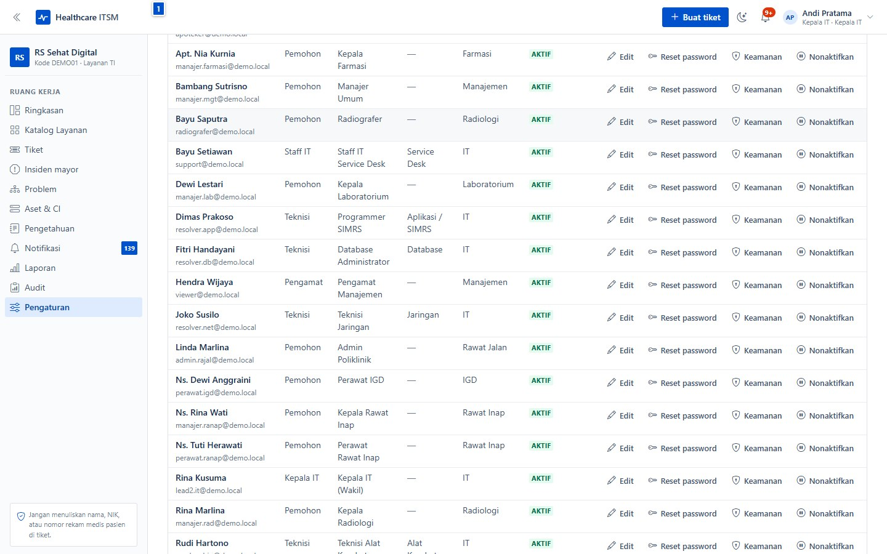

- **Tambah anggota** — isi nama, email, role (`Pemohon`, `Staff IT`, `Teknisi`,
  `Pengamat`), unit, jabatan, dan tim.
- **Reset password** — memaksa anggota mengganti password saat masuk berikutnya.
- **Keamanan** — mereset 2FA anggota yang kehilangan perangkat dan kode
  pemulihan.
- **Nonaktifkan** — menutup akses tanpa menghapus riwayat tiket, komentar, dan
  audit.
- Undangan dikirim lewat email dengan password awal yang wajib diganti saat
  login pertama. Bila SMTP belum dikonfigurasi, serahkan password awal secara
  manual.

### Mengundang satu anggota

Klik **Tambah anggota**, lalu isi data akun.

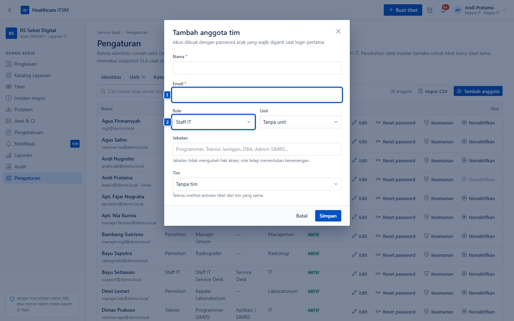

Role menentukan kewenangan; unit menentukan approval dan antrean. Jabatan hanya
label, tidak menambah akses. Teknisi hanya melihat tiket timnya dan tiket yang
ditugaskan kepadanya.

### Impor massal dari CSV

Untuk onboarding puluhan sampai ratusan staf, gunakan **Impor CSV**.

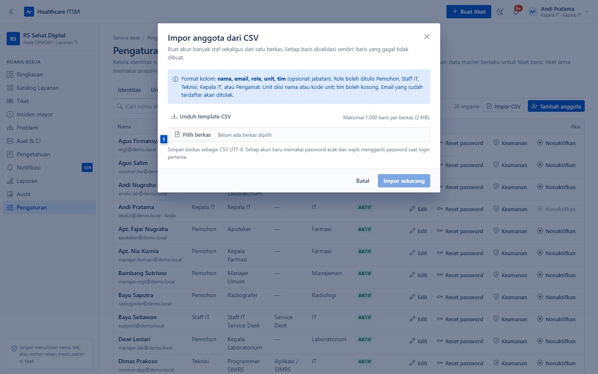

1. Unduh **template CSV**, isi per baris: nama, email, role, unit, tim, jabatan.
2. Unggah berkas (maksimal 1.000 baris, 2 MB).
3. Setiap baris divalidasi; ringkasan menampilkan jumlah berhasil dan gagal
   beserta alasannya. Duplikat ditolak.
4. Unduh **kredensial** hasil impor — password awal hanya ditampilkan sekali di
   sana. Bagikan secara aman; pengguna wajib menggantinya saat login pertama.

Uji dengan 2–3 baris lebih dulu sebelum mengimpor seluruh staf.

## 9. Laporan SLA

Menu **Laporan** menampilkan compliance, tren, dan waktu penyelesaian.

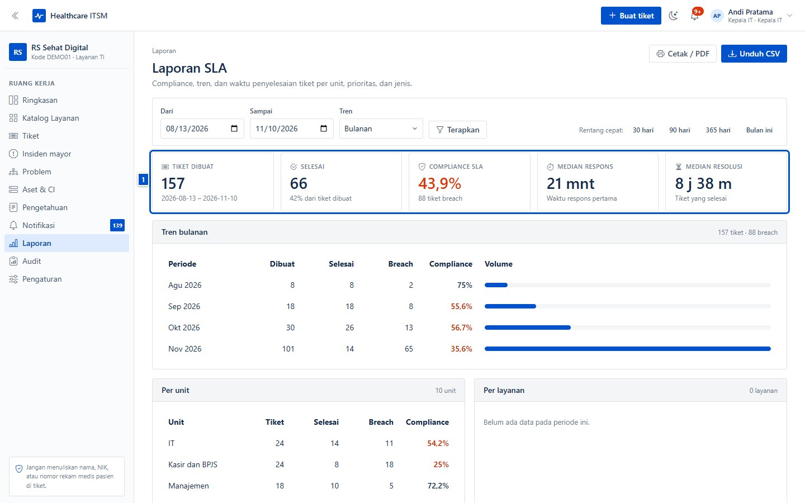

- Atur **Dari/Sampai** dan **Tren** (harian/bulanan), lalu klik **Terapkan**.
  Pilihan cepat 30/90/365 hari tersedia.
- KPI: tiket dibuat, selesai, compliance SLA, median respons, median resolusi.
- **Tren bulanan** menunjukkan volume dan breach per periode.
- **Per unit** dan **Per layanan** membantu melihat area yang perlu diperbaiki.
- **Unduh CSV** untuk analisis lanjutan; **Cetak / PDF** untuk laporan resmi.

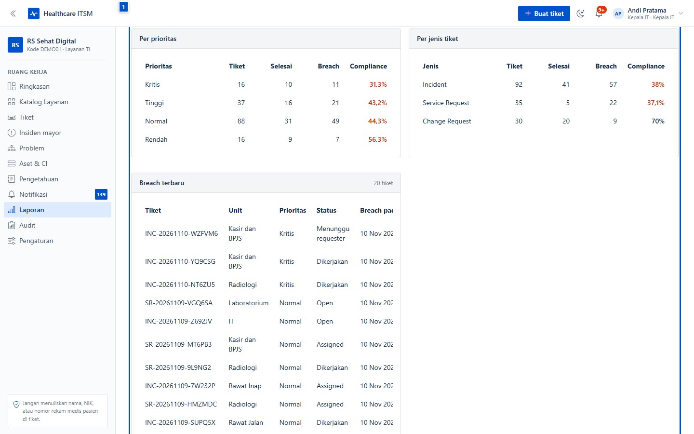

Angka diambil dari data tiket, bukan klaim manual. Pastikan tiket ditutup dengan
benar agar laporan mencerminkan kenyataan.

### Laporan terjadwal

Bagian **Laporan terjadwal** mengirim ringkasan otomatis ke email.

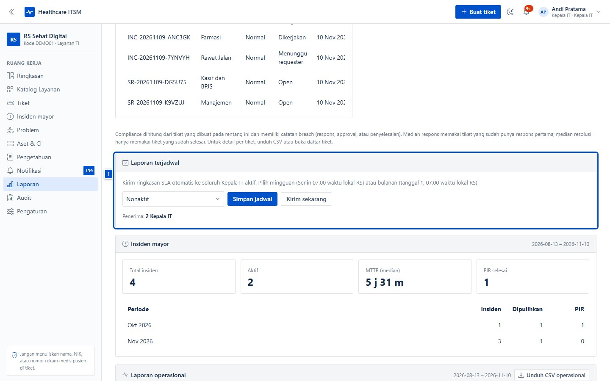

- Tentukan penerima, periode (mingguan/bulanan), dan jam kirim.
- Simpan jadwal; job cron mengirim ringkasan berisi angka utama dan tautan ke
  halaman laporan.
- Uji sekali dengan alamat Anda sendiri sebelum menambahkan manajemen.

## 10. Audit

Menu **Audit** menampilkan jejak aktivitas: siapa melakukan apa, kapan, dan pada
record mana.

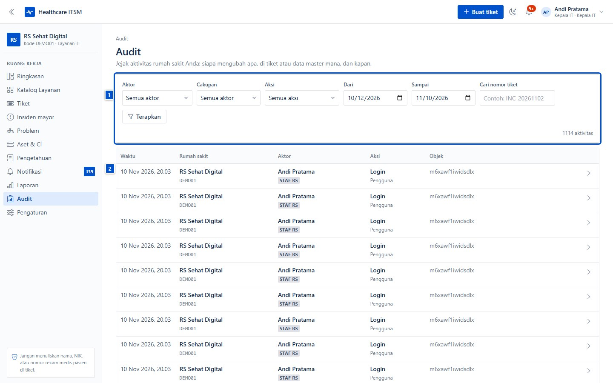

- Filter berdasarkan rentang tanggal, aktor, aksi, dan koleksi.
- Audit bersifat **append-only**: API menolak perubahan dan penghapusan.
- Gunakan audit untuk menjawab pertanyaan "siapa mengubah SLA/approval ini?"
  atau saat investigasi insiden keamanan.

## Ceklis admin rumah sakit baru

- [ ] Logo dan zona waktu benar.
- [ ] Unit, kategori, dan kepala unit lengkap.
- [ ] Katalog layanan dan item permintaan sesuai alur rumah sakit.
- [ ] Kebijakan SLA dan hari libur tahun berjalan diisi.
- [ ] Titik QR dibuat, diuji, dan ditempel per unit.
- [ ] Tim diundang (atau impor CSV), role dan unit benar.
- [ ] SMTP diuji; email undangan dan reset password sampai.
- [ ] Laporan SLA diperiksa, jadwal laporan diuji ke email sendiri.
- [ ] Audit dicek setelah perubahan besar.

## Kalau macet

| Gejala | Penyebab umum | Yang dilakukan |
|---|---|---|
| Menu **Pengaturan** tidak muncul | Bukan peran Kepala IT | Minta Kepala IT menaikkan peran |
| Anggota tidak menerima undangan | SMTP belum dikonfigurasi atau email salah | Periksa setelan email; serahkan password awal manual |
| Impor CSV gagal seluruhnya | Header/format tidak sesuai template | Unduh ulang template, cek kolom dan pemisah |
| Baris CSV ditolak | Email duplikat, role/unit tidak dikenal | Perbaiki baris, impor ulang; baris sukses tidak diulang |
| SLA terlihat tidak wajar | Zona waktu atau hari libur belum benar | Periksa Identitas dan Hari libur |
| QR menampilkan "Tautan tidak aktif" | Token diganti/dinonaktifkan | Cetak QR terbaru dari tab Titik QR |
