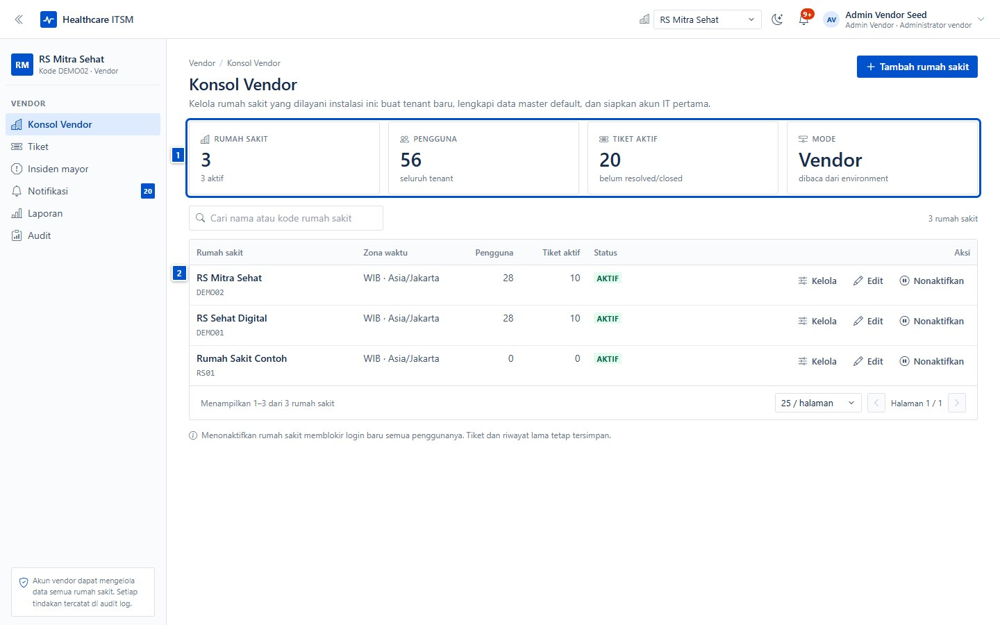
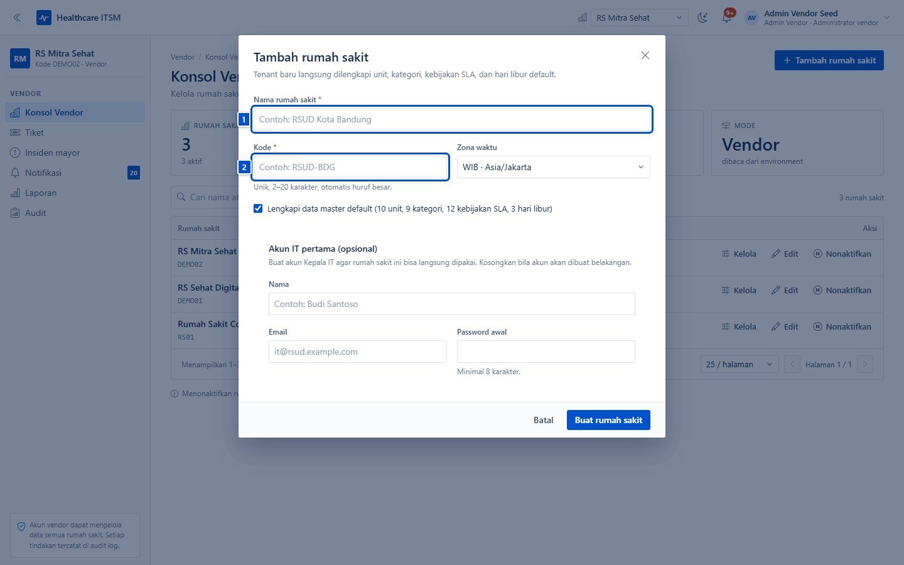
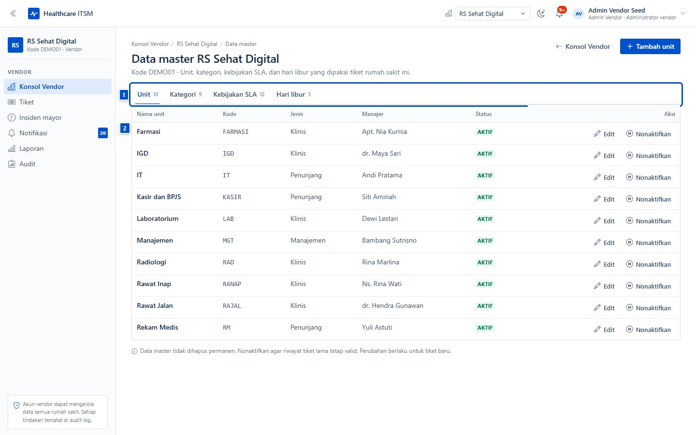
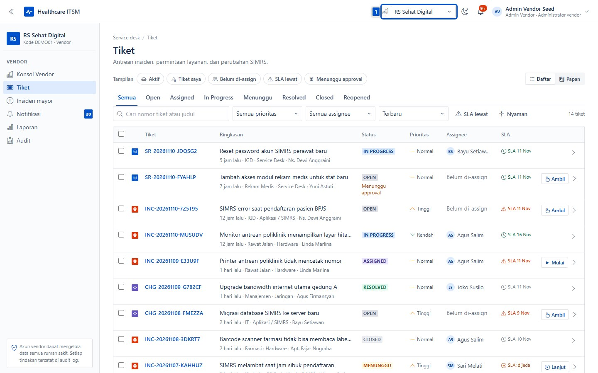
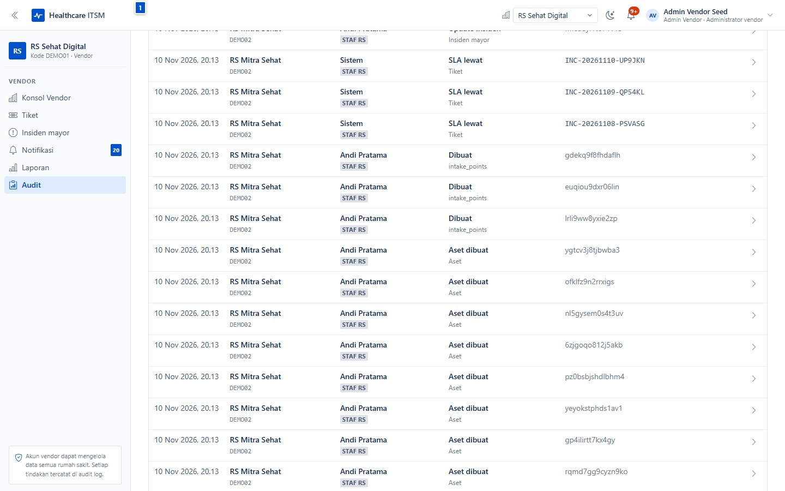

# Konsol vendor (mode multi-rumah sakit)

| | |
|---|---|
| **Untuk** | Staf platform/vendor yang mengelola beberapa rumah sakit |
| **Prasyarat** | Instalasi berjalan dengan `TENANCY_MODE=vendor` dan akun platform |
| **Waktu** | ± 10 menit |
| **Hasil** | Rumah sakit baru bisa dibuat, data master disiapkan, dan tiket lintas RS dipantau |

Bab ini hanya berlaku untuk instalasi **mode vendor**. Pada mode standalone,
menu **Konsol Vendor** tidak muncul dan semua data berada di satu rumah sakit.

> Akun vendor dapat mengelola data semua rumah sakit pada instalasi ini. Setiap
> tindakan tercatat di audit log. Aturan data pasien tetap berlaku: jangan
> menyalin identitas pasien ke tiket, komentar, atau lampiran.

## 1. Konsol Vendor

Masuk dengan akun platform (contoh demo `vendor.seed@demo.local`), lalu buka
menu **Konsol Vendor**.

- **(1) KPI** — jumlah rumah sakit (aktif/total), pengguna, tiket aktif, dan
  mode tenancy yang sedang berjalan.
- **(2) Daftar rumah sakit** — kode, zona waktu, jumlah pengguna, tiket aktif,
  dan status. Dari sini tersedia aksi **Kelola**, **Edit**, dan
  **Nonaktifkan**.
- Kolom **Status** menunjukkan `AKTIF`. Menonaktifkan rumah sakit memblokir
  login semua penggunanya, tetapi tiket dan riwayat lama tetap tersimpan.

Pemilih rumah sakit di kanan atas menentukan rumah sakit aktif untuk menu
**Tiket**, **Laporan**, dan halaman kerja lainnya.

## 2. Membuat rumah sakit baru

Klik **Tambah rumah sakit**, lalu isi identitas rumah sakit dan akun admin
pertamanya.

1. **(1) Nama rumah sakit** — nama resmi yang tampil di aplikasi.
2. **(2) Kode** — kode unik singkat (mis. `DEMO03`), dipakai di laporan dan
   audit.
3. **Zona waktu** — dipakai menghitung SLA dan menjadwalkan laporan.
4. **Admin pertama** — nama, email, dan password awal Kepala IT rumah sakit
   tersebut. Password wajib diganti saat login pertama.

Setelah dibuat, sistem menyiapkan data master default: unit, kategori masalah,
kebijakan SLA, dan hari libur dasar. Lengkapi sebelum serah terima.

> Jangan memakai nama rumah sakit contoh untuk produksi. Nonaktifkan tenant
> percobaan agar tidak muncul di laporan dan daftar.

## 3. Mengelola data master rumah sakit

Klik **Kelola** pada baris rumah sakit untuk membuka data master tenant tersebut.

- **(1) Tab data master** — Unit, Kategori, Layanan, Titik QR, Kebijakan SLA,
  Hari libur, dan Tim. Isinya sama dengan menu **Pengaturan** milik Kepala IT.
- **(2) Daftar data** — perubahan di sini langsung berlaku untuk rumah sakit
  tersebut, dan tercatat di audit.

Pembagian kerja yang disarankan: vendor menyiapkan struktur awal (unit,
kategori, SLA), lalu Kepala IT rumah sakit melanjutkan katalog layanan, tim,
dan titik QR.

## 4. Melihat tiket lintas rumah sakit

Pilih rumah sakit aktif di kanan atas, lalu buka menu **Tiket**.

- **(1) Pemilih rumah sakit** — semua menu kerja mengikuti pilihan ini.
- Antrean, filter, papan, dan aksi tiket bekerja seperti pada instalasi biasa.
- Data antar rumah sakit terpisah: tiket RS A tidak muncul saat RS B dipilih,
  dan laporan hanya menghitung tenant aktif.
- untuk dukungan pilot, vendor bisa ikut menangani tiket tanpa meminta akun
  rumah sakit — semua aksinya tetap tercatat.

## 5. Audit lintas rumah sakit

Menu **Audit** menampilkan aktivitas dari seluruh tenant yang dikelola.

- Filter berdasarkan tanggal, aktor, aksi, dan koleksi.
- Audit dipakai saat serah terima, investigasi insiden, atau menjawab
  pertanyaan "siapa mengubah data master ini?".
- Audit bersifat append-only; tidak ada penghapusan lewat API.

## Ceklis onboarding rumah sakit baru

- [ ] Nama, kode, dan zona waktu benar.
- [ ] Admin pertama bisa masuk dan sudah mengganti password.
- [ ] Unit dan kepala unit diisi.
- [ ] Kategori masalah dan katalog layanan disesuaikan.
- [ ] Kebijakan SLA dan hari libur tahun berjalan diisi.
- [ ] Titik QR dibuat, diuji, dan siap ditempel.
- [ ] Tim diimpor/diundang; role dan unit benar.
- [ ] SMTP diuji (undangan dan reset password sampai).
- [ ] Laporan SLA pertama diperiksa bersama Kepala IT.
- [ ] Tenant percobaan dinonaktifkan.

## Kalau macet

| Gejala | Penyebab umum | Yang dilakukan |
|---|---|---|
| Menu **Konsol Vendor** tidak ada | Instalasi berjalan mode standalone | Set `TENANCY_MODE=vendor` lalu restart PocketBase |
| Tidak bisa membuat rumah sakit | Kode sudah dipakai | Ganti kode unik lain |
| Admin pertama tidak bisa masuk | Email salah atau SMTP belum siap | Periksa email; serahkan password awal manual |
| Tiket rumah sakit lain tidak muncul | Rumah sakit aktif belum diganti | Pilih tenant di pemilih kanan atas |
| Rumah sakit tidak bisa diakses pengguna | Status tenant nonaktif | Aktifkan kembali lewat **Edit** |
