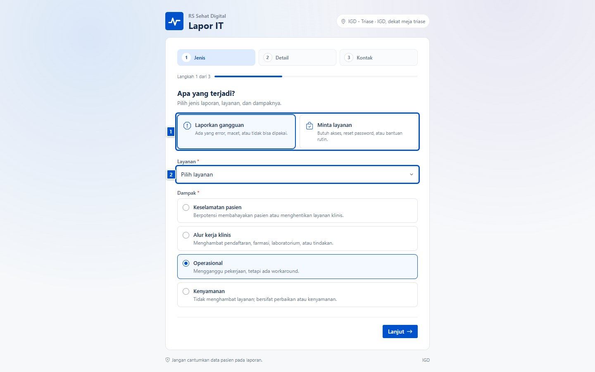
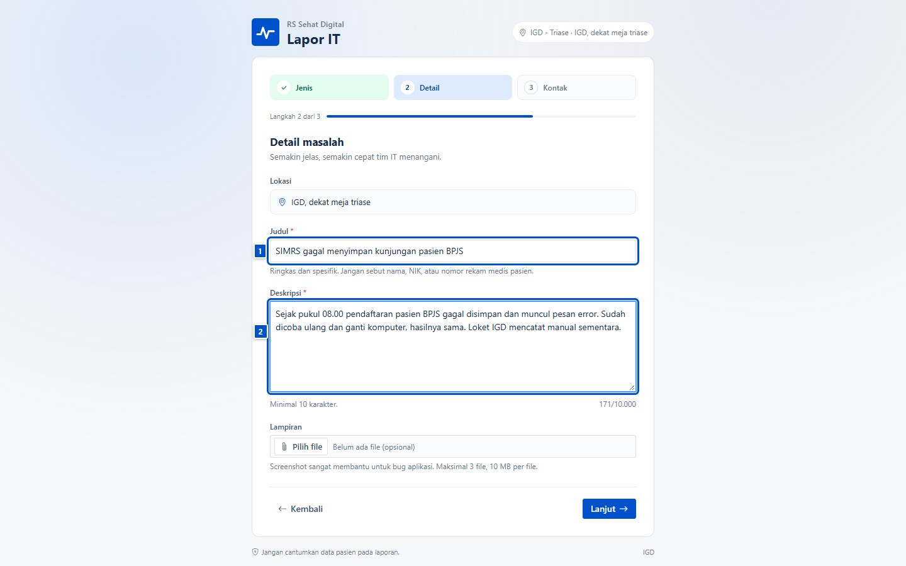
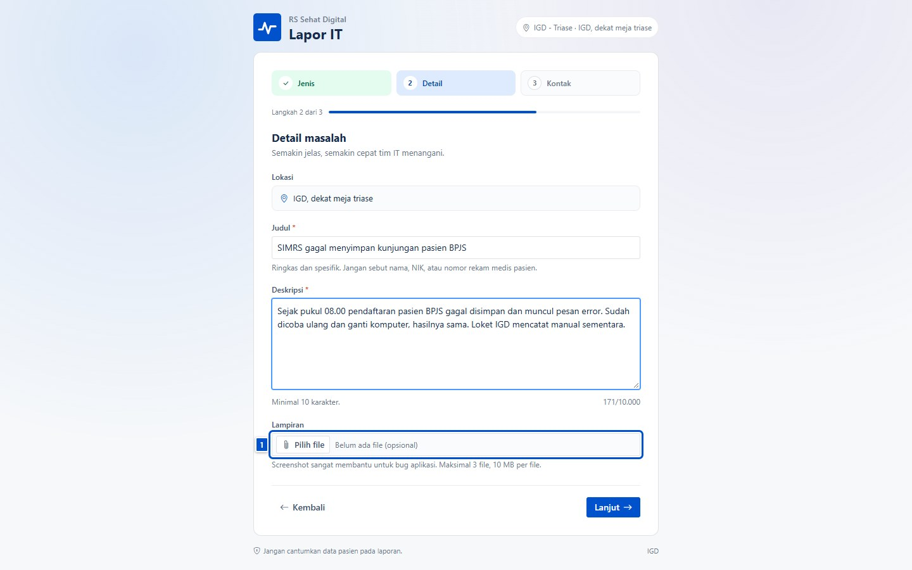
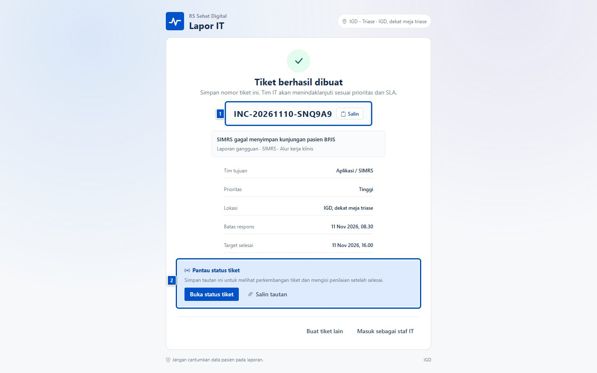
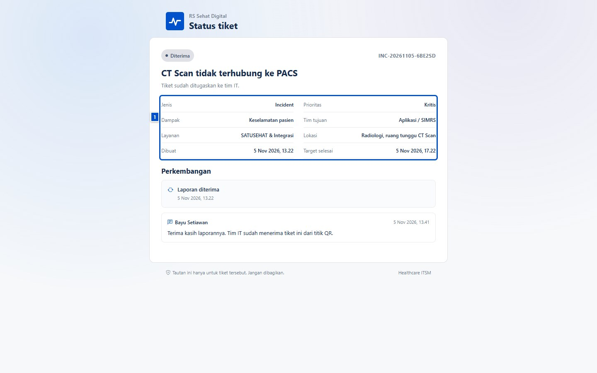
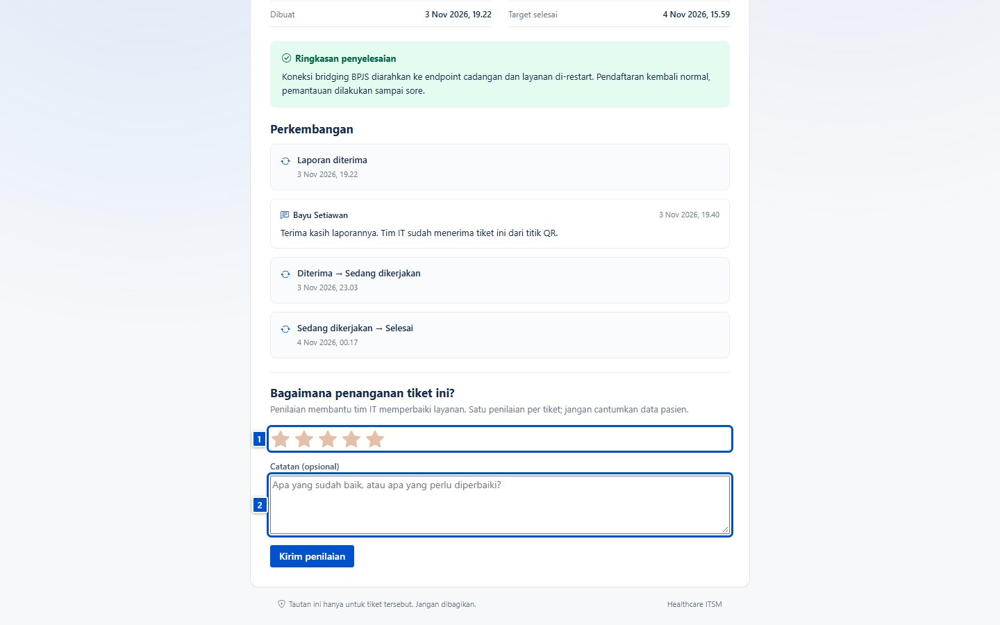

# Lapor lewat QR tanpa login

| | |
|---|---|
| **Untuk** | Pelapor tamu: staf unit, petugas loket, siapa pun yang memindai QR di unit |
| **Prasyarat** | QR resmi dari unit (ditempel di meja/loket) dan koneksi ke jaringan rumah sakit |
| **Waktu** | ± 2 menit |
| **Hasil** | Laporan masuk ke antrean tim IT, dengan nomor tiket dan tautan status |

Halaman ini tidak memerlukan akun. Laporan tetap tercatat atas nama unit dan
titik QR tempat Anda memindai, sehingga tim IT tahu lokasi dan layanan yang
terdampak.

> **Jangan cantumkan data pasien.** Nama pasien, NIK, nomor rekam medis, dan
> alamat tidak boleh ditulis di judul, deskripsi, komentar, maupun lampiran.
> Gunakan kanal aman yang ditentukan rumah sakit bila membutuhkan data itu.

## 1. Memindai QR dan mengisi laporan

Pindai QR di unit (mis. meja triase IGD) dengan kamera ponsel. Halaman
**Lapor IT** terbuka dan menampilkan lokasi titik QR di kanan atas.

1. **(1) Jenis laporan** — **Laporan gangguan** untuk sesuatu yang rusak/error,
   **Minta layanan** untuk permintaan rutin seperti reset password.
2. **(2) Layanan** — pilih layanan yang paling sesuai; ini menentukan tim dan
   SLA. Contoh: `SIMRS` untuk masalah pendaftaran.
3. **Dampak** — pilih yang paling jujur: keselamatan pasien, alur kerja klinis,
   operasional, atau kenyamanan. Prioritas awal dihitung dari sini.

Klik **Lanjut**.

## 2. Menulis detail dan menambahkan lampiran

Lokasi terisi otomatis mengikuti titik QR. Tulis judul singkat dan deskripsi
yang cukup untuk ditindaklanjuti tanpa bertanya balik.

1. **(1) Judul** — spesifik, mis. "SIMRS gagal menyimpan kunjungan pasien
   BPJS". Jangan tulis "error" saja.
2. **(2) Deskripsi** — apa yang terjadi, sejak kapan, pesan error, dan apa yang
   sudah dicoba.

Screenshot pesan error sangat membantu. Klik **Pilih file** untuk menambahkan
lampiran (maksimal 3 file, 10 MB per file).

> Potong atau tutupi identitas pasien sebelum mengunggah screenshot. Jangan
> mengunggah foto layar yang memuat nama, NIK, atau nomor rekam medis.

Klik **Lanjut** untuk ke langkah kontak.

## 3. Mengisi kontak dan mengirim

Isi nama dan kontak yang bisa dihubungi tim IT (email atau nomor
telepon/WhatsApp), lalu centang pernyataan bahwa laporan tidak memuat data
pasien.

Klik **Kirim laporan**. Laporan langsung masuk ke antrean tim IT; Anda tidak
perlu menunggu di halaman itu.

## 4. Nomor tiket dan tautan status

Setelah terkirim, halaman menampilkan nomor tiket dan ringkasan laporan.

1. **(1) Nomor tiket** — salin dan simpan (mis. `INC-20261110-SNQ9A9`). Nomor
   ini dipakai saat menghubungi service desk.
2. **(2) Pantau status tiket** — simpan tautannya. Tautan ini hanya berlaku
   untuk tiket tersebut; jangan dibagikan ke orang lain.

Bila Anda mengisi email, tautan status juga dikirim ke email tersebut.

## 5. Memantau status tanpa login

Buka tautan status kapan saja untuk melihat status, target waktu, dan
perkembangan penanganan.

- **(1) Ringkasan tiket** — jenis, prioritas, layanan, lokasi, dan target
  selesai.
- **Perkembangan** — pembaruan publik dari tim IT, termasuk ringkasan
  penyelesaian saat tiket selesai. Catatan internal tim IT tidak ditampilkan.
- Bila tautan hilang, minta service desk mengirimkannya kembali; tautan tidak
  bisa ditebak.

## 6. Menilai penanganan

Setelah tiket selesai, halaman status menampilkan form penilaian. Pilih 1–5
bintang, tambahkan catatan bila perlu, lalu klik **Kirim penilaian**.

Satu tiket hanya bisa dinilai sekali. Penilaian membantu tim IT melihat layanan
yang perlu diperbaiki.

## Untuk staf IT: menyiapkan QR

- Cetak QR dari **Pengaturan → Titik QR**, tempel di lokasi yang mudah terlihat
  (meja triase, loket pendaftaran, nurse station).
- Uji QR dari ponsel sebelum dipasang; pastikan halaman terbuka dan lokasi di
  kanan atas sesuai unit.
- Satu titik QR untuk satu lokasi fisik. Jangan memakai satu QR untuk beberapa
  unit — laporan akan tercatat di lokasi yang salah.
- QR hanya berisi tautan; tidak ada data pasien di dalamnya.

## Kalau macet

| Gejala | Penyebab umum | Yang dilakukan |
|---|---|---|
| Halaman "Tautan tidak aktif" | QR sudah dinonaktifkan atau salah ketik | Minta staf IT memeriksa titik QR |
| Tombol **Lanjut** tidak jalan | Layanan atau dampak belum dipilih | Periksa pesan error di atas form |
| Tidak bisa mengirim | Kontak tidak valid atau pernyataan data pasien belum dicentang | Isi email/telepon yang benar dan centang pernyataan |
| Lampiran ditolak | Lebih dari 3 file atau lebih dari 10 MB | Kecilkan/kompres file, atau kirim tautan di deskripsi |
| Lupa tautan status | Halaman ditutup | Hubungi service desk dengan nomor tiket |
