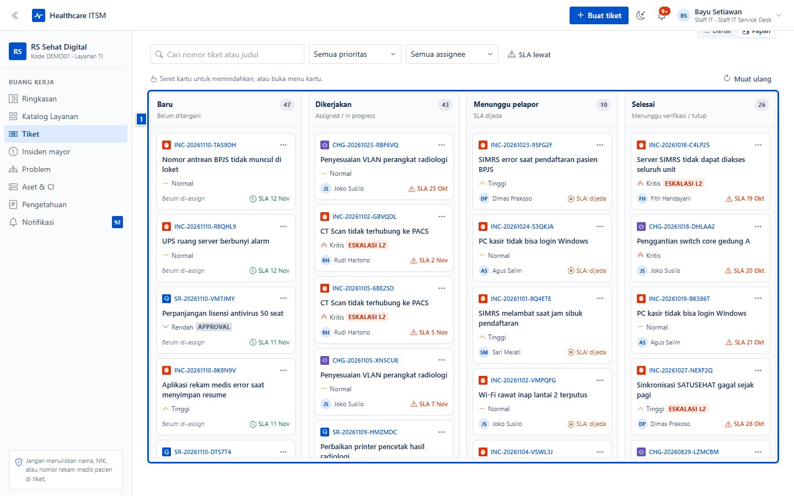

# Lampiran: peran, status, dan glosarium

| | |
|---|---|
| **Untuk** | Semua pembaca panduan |
| **Prasyarat** | — |
| **Waktu** | 5 menit |
| **Hasil** | Paham siapa boleh apa, arti status tiket, dan istilah yang dipakai |

## 1. Peran dan kewenangan

| Peran | Bisa melihat | Bisa melakukan |
|---|---|---|
| **Pemohon** | Tiket miliknya dan tiket unitnya | Membuat tiket, berkomentar, menilai CSAT, membuka kembali tiket sendiri |
| **Kepala unit** | Seperti pemohon, plus approval unit | Menyetujui/menolak/mendelegasikan permintaan unit |
| **Staff IT** | Semua tiket rumah sakit | Triage, assign, mengerjakan, merge, menutup, mengelola aset/problem/KB |
| **Teknisi (resolver)** | Tiket timnya dan tiket yang ditugaskan | Mengambil tiket tim, mengerjakan, menyelesaikan |
| **Pengamat** | Laporan dan audit | Hanya membaca; tidak bisa membuka tiket |
| **Kepala IT** | Semua, termasuk pengaturan dan audit | Semua aksi staf IT + mengelola data master, tim, SLA, laporan |
| **Staf vendor** | Rumah sakit yang dikelola | Konsol vendor dan tiket lintas tenant |

Jabatan (job title) hanya label; kewenangan ditentukan peran. Unit menentukan
approval dan antrean, bukan akses.

## 2. Siklus status tiket

Papan Kanban memakai status yang sama dengan daftar tiket.

| Status | Arti | Siapa yang mengubah |
|---|---|---|
| `Open` | Baru masuk, belum ditangani | Sistem (saat dibuat) |
| `Assigned` | Sudah punya penanggung jawab | Staf IT / teknisi |
| `In Progress` | Sedang dikerjakan | Penanggung jawab |
| `Menunggu` | Menunggu informasi dari pelapor/pihak lain; SLA selesai dijeda | Penanggung jawab |
| `Resolved` | Pekerjaan selesai, menunggu konfirmasi/penutupan | Penanggung jawab |
| `Closed` | Selesai dan ditutup; komentar baru ditolak | Staf IT / Kepala IT |
| `Reopened` | Dibuka kembali karena masalah berulang | Pelapor atau staf IT |

Tiket duplikat tidak dihapus: tiket sumber ditutup sebagai duplikat dan
komentar/lampirannya dipindahkan ke tiket tujuan (merge).

## 3. SLA singkat

- **Batas respons** — waktu maksimal memberi respons pertama.
- **Batas approval** — waktu maksimal approver memutuskan (untuk permintaan
  yang butuh approval).
- **Batas selesai** — waktu maksimal menyelesaikan pekerjaan.
- Jam dihitung dalam jam kerja rumah sakit dan zona waktu rumah sakit; hari
  libur tidak dihitung.
- Status `Menunggu` menjeda SLA penyelesaian.
- Melewati batas memunculkan peringatan, lalu eskalasi otomatis ke Kepala IT
  (level 2/3) dan notifikasi.

## 4. Glosarium

| Istilah aplikasi | Istilah ITIL | Arti di rumah sakit |
|---|---|---|
| Tiket | Ticket / record | Satu laporan atau permintaan |
| Incident | Incident | Gangguan yang sedang terjadi |
| Service Request | Service request | Permintaan rutin (akses, reset password) |
| Change Request | Change | Perubahan konfigurasi/alur yang direncanakan |
| Problem | Problem | Penyebab bersama dari beberapa insiden |
| Known error | Known error | Masalah yang penyebabnya sudah diketahui |
| Workaround | Workaround | Solusi sementara agar layanan tetap jalan |
| Aset / CI | Asset / configuration item | Perangkat, server, lisensi, alat kesehatan |
| SLA | Service level agreement | Janji batas waktu layanan |
| CSAT | Customer satisfaction | Penilaian kepuasan pelapor (1–5) |
| Approval | Approval | Persetujuan sebelum pekerjaan dimulai |
| CAB | Change advisory board | Komite persetujuan perubahan |
| Insiden mayor | Major incident | Gangguan berdampak luas dengan satu komando |
| PIR | Post-incident review | Tinjauan setelah insiden pulih |
| Triage | Triage | Koreksi prioritas/klasifikasi sebelum dikerjakan |
| Merge | Duplicate merge | Menggabungkan tiket duplikat |

## 5. Keamanan dan data pasien

- Tiket, komentar, lampiran, dan screenshot **tidak boleh** memuat nama pasien,
  NIK, nomor rekam medis, alamat, atau identitas pasien lain.
- Form intake mewajibkan pernyataan (attestation); backend menolak tiket tanpa
  pernyataan itu.
- Lampiran disimpan sebagai berkas terlindungi dan diakses lewat token.
- Audit log append-only; perubahan dan penghapusan ditolak API.
- Deteksi data pasien bersifat kebijakan + pernyataan, bukan DLP otomatis —
  kepatuhan tetap tanggung jawab pengguna.
- Jangan mengunggah screenshot yang masih menampilkan identitas pasien, termasuk
  ke komentar internal.

## 6. FAQ

**Apakah saya bisa melihat tiket unit lain?**
Hanya jika Anda staf IT/Kepala IT. Pemohon melihat tiket miliknya dan unitnya.

**Kenapa tombol Buat tiket tidak muncul?**
Akun pengamat bersifat baca-saja. Minta Kepala IT menaikkan peran.

**Kenapa tiket tidak bisa dikomentari?**
Tiket sudah `Closed`. Buka kembali bila masalah berulang, atau buat tiket baru.

**Apakah komentar internal terlihat pelapor?**
Tidak. Hanya staf IT yang melihat komentar dan lampiran internal.

**Kapan tiket boleh ditutup?**
Setelah `Resolved` dan pelapor dikabari; penutupan menandai pekerjaan benar-benar
selesai.

**Bagaimana jika lupa password atau kehilangan perangkat 2FA?**
Gunakan tautan lupa password dari halaman masuk. Untuk 2FA yang hilang, pakai
kode pemulihan; bila habis, minta Kepala IT mereset 2FA akun Anda.

**Apakah laporan SLA bisa diunduh?**
Ya, dari menu Laporan: **Unduh CSV** atau **Cetak / PDF**. Kepala IT juga bisa
menjadwalkan laporan mingguan/bulanan lewat email.

**Mengapa angka laporan berbeda dengan hitungan manual?**
Laporan memakai tanggal dan zona waktu rumah sakit, serta hanya menghitung tiket
yang tercatat. Pastikan tiket ditutup dan tidak ada duplikat yang belum
digabung.

---

Butuh bantuan? Hubungi service desk rumah sakit melalui menu **Tiket** (atau
QR unit), sertakan nomor tiket bila sudah ada.
