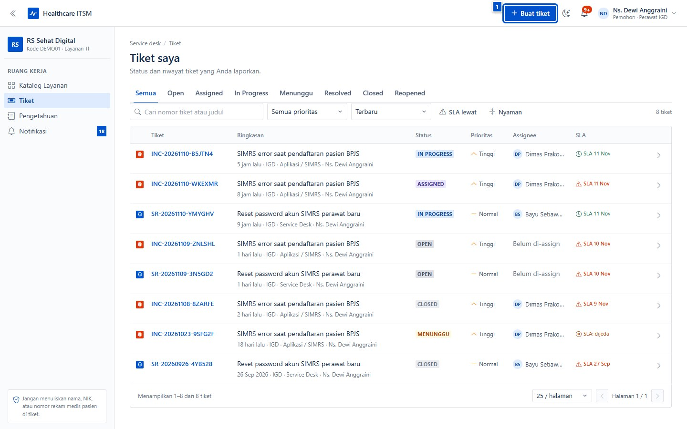
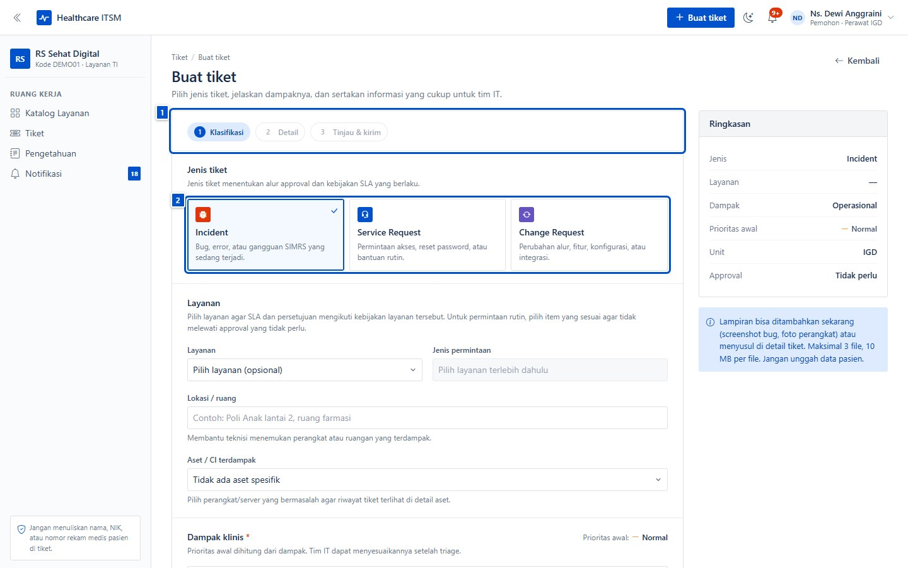

# Templat bab panduan

Salin file ini menjadi `NN-nama-bab.md`, ganti isinya, lalu daftarkan di
`book.json`. Jangan mengubah struktur blok metadata: `tests/unit/guide.test.mjs`
memeriksa keberadaannya.

Aturan singkat:

- Satu tugas = satu bab kecil. Judul memakai kalimat kerja, bukan nama menu.
- Satu langkah = satu gambar. Gambar diberi nomor panggil, dan teks menyebut
  nomornya: "klik **(2) Buat tiket**".
- Alt text wajib dan deskriptif; jangan mengulang judul bab.
- Jangan menuliskan data pasien, kredensial, atau URL internal di gambar
  maupun teks.

---

# Judul tugas yang dijelaskan

| | |
|---|---|
| **Untuk** | Peran/pembaca yang memakai bab ini |
| **Prasyarat** | Keadaan yang harus sudah terpenuhi |
| **Waktu** | ± perkiraan waktu |
| **Hasil** | Keadaan setelah langkah selesai |

Satu paragraf pengantar: masalah apa yang diselesaikan bab ini.

## 1. Langkah atau bagian pertama

1. Buka menu **Contoh**, lalu klik **Tombol**.

   

2. Pilih opsi yang sesuai.

   

## Yang perlu diperhatikan

> Peringatan penting (keamanan data, izin, atau konsekuensi yang tidak bisa
> dibatalkan) diletakkan di blok kutipan seperti ini.

## Kalau macet

| Gejala | Penyebab umum | Yang dilakukan |
|---|---|---|
| Gejala yang terlihat pengguna | Penyebab yang paling sering | Tindakan perbaikan |
